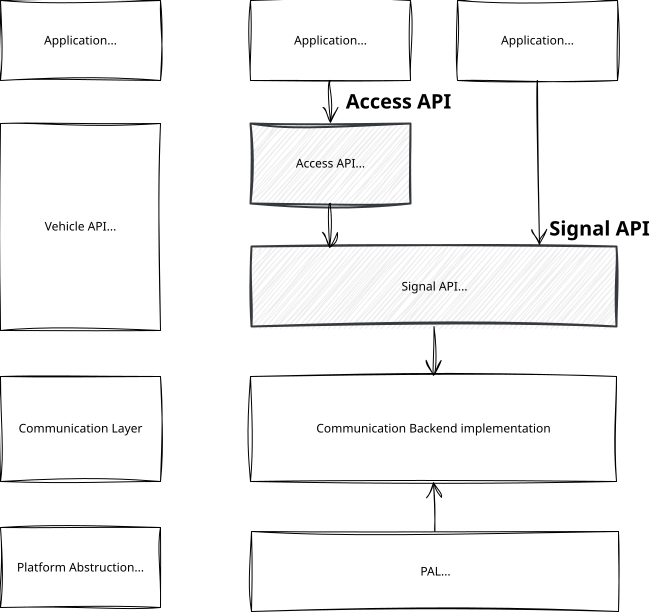
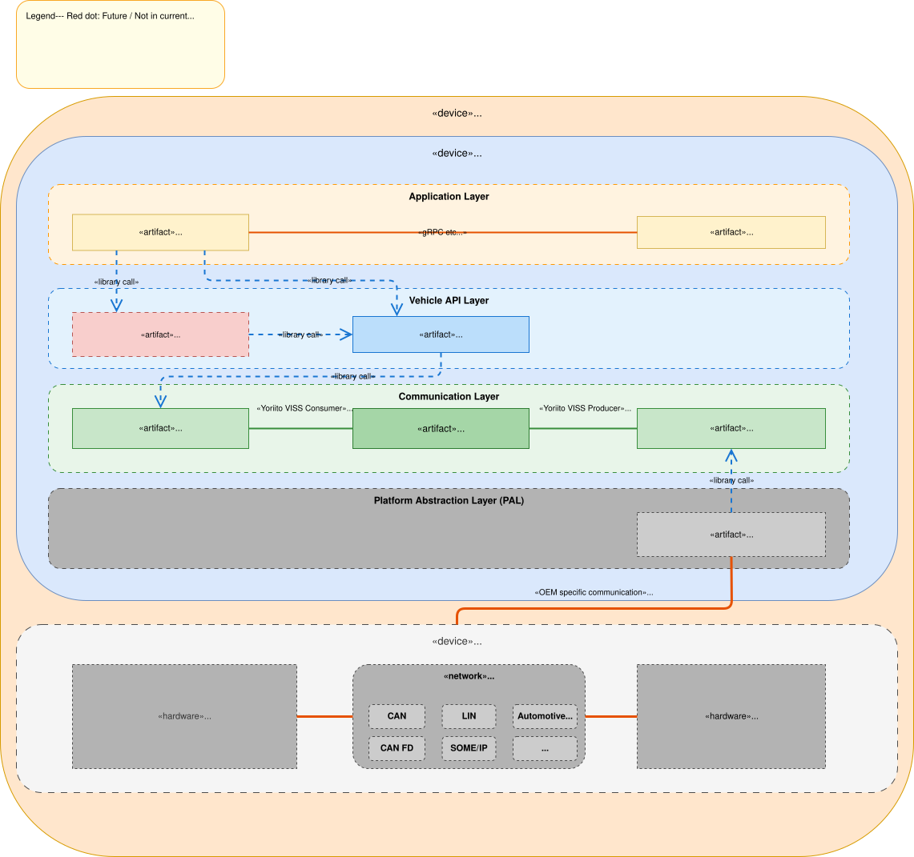
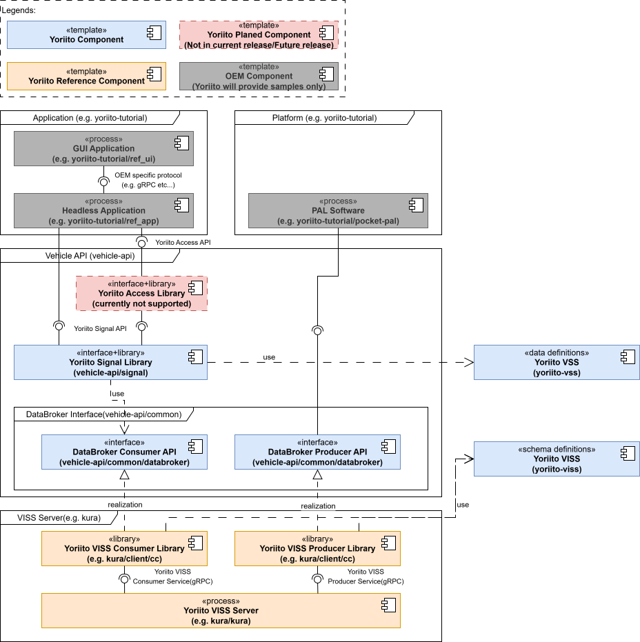

# Yoriito Vehicle API — Architecture Overview

## Introduction

This document provides an architectural overview of the Yoriito Vehicle API.

For detailed specifications, API references, and tutorials, please refer to the respective design documents.

Yoriito Vehicle API is organized by responsibilities and developer ergonomics:

- Signal API (low-level, asynchronous): direct access to vehicle signals and actuators with Get/Set/Subscribe/Unsubscribe. Under-the-hood transports (e.g., CAN, SOME/IP, DDS) are abstracted while behavior and timing are specified.
- Access API (high-level, task-centric): developer-friendly composites that combine multiple signals into intuitive domain operations. Designed for clarity and efficiency in app code.
- PAL (Platform/Porting Abstraction Layer): mediates between the standardized Yoriito Vehicle APIs and OEM- or ECU-specific implementations. PAL is responsible for mapping abstract signals and operations to concrete vehicle buses, ECUs, and platform services, so that application code and API behavior remain stable even as hardware, network topology, or supplier components differ between vehicle lines.
- Communication Backend (Communication Layer): An abstraction layer that standardizes communication and data specifications to interconnect the Signal API, Access API, and PAL. Standardization is performed with reference to COVESA VISS v3.

## Architecture Overview

The following diagram illustrates the runtime configuration of the Yoriito Vehicle API,
showing how each layer is deployed and interconnected from the application down to the vehicle platform.

The system consists of the following layers:

- **Application Layer** — Headless/UI applications using vehicle signals.
- **Vehicle API Layer** — APIs and libraries that provide vehicle signal access to applications (Yoriito Signal API / Library, Yoriito Access API / Library).
- **Communication Layer** — A client-server architecture based on the Yoriito VISS protocol (Consumer Library, Producer Library, VISS Server). Yoriito VISS is the Vehicle Information Service Specification derived from **COVESA VISS v3**.
- **Platform Abstraction Layer (PAL)** — Abstracts vehicle platform specifics and handles I/O with in-vehicle networks (CAN, CAN FD, LIN, SOME/IP, etc.). This layer abstracts the differences between OEM platforms and converts them to a VSS (Vehicle Signal Specification) tree structure.

Layers are connected via library calls or the Yoriito VISS protocol.

### Components

#### Yoriito Signal Library / API

Yoriito Signal API is an application-facing API definition that provides access to individual vehicle signals — sensor values and actuator operations — through Set / Get / Subscribe operations. Each API entry corresponds 1:1 with a signal defined in Yoriito VSS, and the API code is generated from these definitions.

Yoriito Signal Library is a shared library that implements the Yoriito Signal API.

Yoriito Signal API and Yoriito Access API are collectively referred to as the **Yoriito Vehicle API**.

#### Yoriito Access Library / API

Yoriito Access API is a high-level API definition that provides use-case-oriented vehicle operations (e.g., batch door lock) and simplified data access, designed with application-side usability as a priority.

Yoriito Access Library is a shared library that implements the Yoriito Access API.

> **Note:** Yoriito Access API and Yoriito Access Library are at the conceptual stage and are not included in the current release.

#### DataBroker Consumer API / DataBroker Producer API

DataBroker Consumer/Producer API are interface definitions that abstract the means of accessing the Yoriito VISS Server (data broker).

DataBroker Consumer API is an upper-layer-facing interface, used internally by the Yoriito Signal Library. 
This API provides a means to access the Yoriito VISS Server from the upper layers. 
It supports reading current sensor values, setting actuator target values, and subscribing to sensor value changes.

DataBroker Producer API is a lower-layer-facing interface, used by PAL Software. 
This API provides a means to access the Yoriito VISS Server from the lower layers. 
It supports updating current sensor values, retrieving actuator target values, and subscribing to actuator target value changes.

By introducing these interfaces, neither the Yoriito Signal Library nor PAL Software depends directly on a specific data broker implementation (e.g., kura). 
The Yoriito VISS Consumer/Producer Library are positioned as realizations of the DataBroker Consumer/Producer API, respectively. 
Should the data broker implementation be replaced or extended in the future, only the realizing libraries need to be substituted, minimizing the impact on the upper and lower layers.

#### Yoriito VISS Consumer Library

Yoriito VISS Consumer Library is a shared library that provides a concrete implementation of the DataBroker Consumer API using the Yoriito VISS protocol. 
It wraps the client code generated from the Yoriito VISS schema, communicating with the Yoriito VISS Server via gRPC.

The Yoriito Signal Library does not depend on this library implementation directly; instead, it accesses the data broker through the DataBroker Consumer API. 
The Yoriito VISS Consumer Library is loaded at runtime as a realization of that interface.

#### Yoriito VISS Producer Library

Yoriito VISS Producer Library is a shared library that provides a concrete implementation of the DataBroker Producer API using the Yoriito VISS protocol. 
Like the Consumer Library, it wraps the client code generated from the Yoriito VISS schema, communicating with the Yoriito VISS Server via gRPC.

PAL Software does not depend on this library implementation directly; instead, it accesses the data broker through the DataBroker Producer API. 
The Yoriito VISS Producer Library is loaded at runtime as a realization of that interface.

#### Yoriito VISS Server

Yoriito VISS Server is a centralized server that functions as a data hub and data broker. 
It manages the VSS data tree, holds current sensor values supplied by the PAL, stores actuator target values set by applications, and propagates error and availability information between layers.

All exchanges between the application side (via the DataBroker Consumer API) and the platform side (via the DataBroker Producer API) pass through this server.

#### Yoriito VSS

Yoriito VSS is a set of vehicle signal definitions, extended and maintained for the Yoriito Vehicle API, based on the COVESA VSS (Vehicle Signal Specification). It does not have a directly corresponding software component; rather, it serves as a data definition that is referenced or consumed by other components throughout the system.

OEMs and suppliers derive vehicle-specific signal definitions from this base set to match their platform configurations.

#### Yoriito VISS

Yoriito VISS is a set of VISS message schema definitions, extended and maintained for the Yoriito Vehicle API, based on COVESA VISS v3. It defines the protocol and message formats used for communication with the Yoriito VISS Server.

The Yoriito VISS Consumer Library and Producer Library are generated from this schema.

#### PAL Software

PAL (Platform Abstraction Layer) Software sits between the vehicle platform and the Yoriito VISS Server. Its primary responsibilities are:

- **Signal acquisition and conversion** — Acquires raw signals from the vehicle platform, converts them into Yoriito VSS-defined formats, and supplies them to the Yoriito VISS Server via the Producer API.
- **Control request delivery** — Retrieves actuator target values from the Yoriito VISS Server and converts them into commands that the vehicle platform can process.
- **VSS node management** — Defines and manages which VSS nodes are active for a given vehicle configuration, through VISS Server configuration or Producer API functions.

By encapsulating vehicle-platform-specific details within the PAL, application developers can access vehicle signals through the Yoriito Signal API without concern for the underlying platform. Conversely, PAL developers can focus on vehicle platform integration without knowledge of application logic. This separation improves cross-vehicle portability of applications.

### Relationship between Components

The data flow through the system follows two primary paths:

**Application → Vehicle Platform (control path):**
Applications call the Yoriito Signal API (Set), which delegates to the Signal Library. The Signal Library invokes the VISS Consumer Library, which sends requests to the VISS Server via the Yoriito VISS protocol. The VISS Server stores the target value, and PAL Software retrieves it through the VISS Producer Library, converting it into a vehicle-platform-specific command.

**Vehicle Platform → Application (sensing path):**
PAL Software acquires raw signals from the vehicle platform, converts them into VSS-compliant formats, and publishes them to the VISS Server through the VISS Producer Library. Applications receive these values by calling Get or Subscribe on the Yoriito Signal API, which internally reads from the VISS Server via the Consumer Library.

**Generation dependencies:**
Yoriito VSS serves as the root data definition from which multiple artifacts are derived. The Yoriito Signal API is generated from the VSS definitions, ensuring 1:1 correspondence between API entries and signal definitions. The Yoriito VISS schema is also derived from the VSS definitions, and the Consumer and Producer libraries are in turn generated from this schema.

**Reference dependencies:**
PAL Software references the Yoriito VSS definitions to establish mappings between vehicle-platform-specific data structures and the VSS tree. This reference relationship is essential for correct signal conversion at the platform boundary.
