{{ sec_reset(chapter_no) }}

# Part1 Theory  

## {{ h2_sec("What is the Yoriito Vehicle API? 📱🚗") }}  

### {{ h3_sec("Overview") }}  

!!! info "What is the Yoriito Vehicle API?"  
    The Yoriito Vehicle API is an API standardization activity for in-vehicle software in the age of software-defined vehicles (SDV), driven by the Yoriito project (https://yoriito.dev) under a Japan automotive industry consortium (JASPAR, https://www.jaspar.jp/en). With abstracted vehicle functions and consistent behavior definitions, we aim to enable OEMs, suppliers, and third parties (application developers) to develop, verify, and deploy software using a common interface.  

#### Objectives and value  

* **Improve development speed**: Reduce the impact of differences between vehicle models and platforms by standardizing API specifications, behaviors, and tests.  
* **Compatibility and portability**: A common contract enables applications to be reused across multiple vehicle models.  
* **Building an ecosystem**: Providing a developer experience such as SDKs, samples, and simulators makes it easy for third parties to participate.  

!!! note  
    The Yoriito Vehicle API leverages existing standardization work such as COVESA VSS, while focusing on abstraction and testability tailored for software-defined vehicles originating from Japan.  

#### Relationship with other standards and ecosystems  

The Yoriito Vehicle API is being developed to ensure interoperability and alignment with the work of COVESA VSS and other organizations. While leveraging existing assets for vehicle signal semantics, the Yoriito Vehicle API aims to align them with Japanese SDV requirements (safety, quality, accessibility).  

---

### {{ h3_sec("Architecture and API design concepts") }}  

#### Architecture and API layers  

The Yoriito Vehicle API is organized into multiple layers and types based on their purpose and non-functional characteristics.  

* **Signal API (asynchronous / embedded-control‑oriented)**: A low-level API for accessing vehicle signals, such as sensor values and actuator commands. It abstracts underlying differences in protocols like CAN/SOME-IP and defines behaviors, including publish/subscribe patterns and conditional event handling.  

* **Access API (experience / efficiency‑oriented)**: A high-level API that is easy for applications to handle and focused on usability, simplifying aspects like use-case-based operations and data retrieval. It is implemented by combining several Signal APIs as needed.  

* **PAL (Platform Abstraction Layer / lower abstraction layer)**: An abstraction layer that absorbs OEM-specific and platform-specific details such as communication methods, ECU configurations, and security/diagnostic interfaces for each OEM and vehicle model. It enables the Yoriito Vehicle API to interact with them through a common contract (defining capabilities, availability, and error vocabularies). The PAL is responsible for implementing adaptations for each vehicle platform based on the Signal and Access API specifications.  

* **Communication backend (Communication Layer)**: An abstraction layer that standardizes the communication and data specifications for connecting the Signal API, Access API, and PAL, while hiding their implementation details. Its standardization references COVESA VISS v3.  

!!! note  
    The Access API is currently under consideration and is not included in this release.  

#### Key features  

* **Clearly-defined behavior**: Specify not only function signatures but also their behavior, including conditions, errors, availability, and capabilities.  

* **Testability**: An operational model where implementation differences can be easily discovered and corrected through a Common Test Suite (CTS) and simulators.  

* **OSS publication policy**: Promote community participation by widely publishing deliverables, including API specifications, SDKs, runtimes, samples, and tests.  

#### Error model (example)  

The Yoriito Vehicle API focuses on simplifying application‑side handling by organizing errors, which tend to be scattered across implementations and vehicle models, from a common perspective.  

* **Capability (presence/absence of equipment/function)**: – e.g., the requested equipment/function is not installed on the vehicle.  
* **Availability**: – e.g., failure, inactive state, no response  
* **Condition not met (runtime)**: – e.g., safety conditions not met, priority conflict, limit on the number of operations, battery conditions  
* **Invalid request**: – e.g., out‑of‑range arguments, type/structure mismatch  

!!! note  
    With a common error vocabulary and tests, applications can implement exception handling based on consistent failure modes.  

---

### {{ h3_sec("Scope and onboarding guide") }}  

#### What you can do with the Yoriito Vehicle API (example use cases)  

* **Body domain**: Lighting control  
* **Cabin domain**: Door lock/unlock, power window control, climate control settings, seat adjustment, interior light control  
* **Information acquisition**: Vehicle speed, travel distance, acceleration/deceleration, environmental sensors (ambient temperature, illuminance, etc.), vehicle identification information  

!!! note  
    Development is proceeding on two tracks: use-case-driven (creating new value) and domain-driven (standardizing existing functions). Initially, the focus is more on domain-driven development, prioritizing foundational APIs with broad applicability.  

#### Developer experience (DX): SDKs, samples, and simulators  

* **SDK / runtime**: Provide common implementations for API calls, publish/subscribe patterns, error vocabularies, and asynchronous streams.  
* **Samples**: Demonstrate best practices by showing typical use cases (e.g., door locking, A/C setting) with minimal code.  
* **Simulator**: Serve as "dynamic specifications" that comply with the API standards, enabling pre-implementation verification and regression testing.  

!!! note 
    The simulators are under consideration and are not included in the current release.  

#### Best practice for onboarding  

* **Gradual onboarding**: Start with low-risk domains that have clear use cases, such as body and cabin systems, to establish a solid foundation for API operations and testing.  

* **Test‑driven approach**: Control behavioral differences with a common test suite, making porting and verification efforts more plannable.  

* **Contract‑driven design**: Manage capabilities, availability, conditions, and error vocabularies as formal contracts to clearly separate responsibilities between applications and the PAL (Platform Abstraction Layer).  

#### Out‑of‑scope items (not provided by this activity)  

* **Authentication and authorization methods**: The methods for authentication and authorization (e.g., ID management, token/certificate handling, permission models) are out of scope for the Yoriito Vehicle API. This API defines its interfaces and behavior assuming it is called within a properly authenticated and authorized environment.  

* **In-vehicle OS, middleware, and network stacks**: The specifications and implementation methods for the in-vehicle OS, middleware, and network stacks (e.g., CAN, SOME/IP) are out of scope. The Yoriito Vehicle API focuses on the specifications of the abstract APIs (Signal API, Access API, PAL) that operate on top of them.  

* **Vehicle Functions and Safety Concepts**: The presence or absence of the vehicle functions themselves, their design policies, and safety concepts (e.g., HARA, ASIL) are out of scope. The scope of Yoriito Vehicle API is limited to how existing or company-defined vehicle functions are abstracted and provided as APIs.  

* **UX design**: UX designs such as application specifications, screen designs, and user operation flows are out of scope. The Yoriito Vehicle API focuses on defining common vehicle-function interfaces that are usable by applications.  

* **Company-specific operational and lifecycle management**: Company-specific operational and lifecycle management such as OTA update methods, application distribution channels, and auditing/logging practices are out of scope. The Yoriito Vehicle API only addresses the minimal items directly related to interoperability such as API versioning policies.  

---

### {{ h3_sec("Related resources (reference links)") }}  

* [What's New in JASPAR](https://www.jaspar.jp/news/english/716)  
* [Article (Japanese Only)](https://dcross.impress.co.jp/docs/column/column20250716/004142.html)  

---

### {{ h3_sec("FAQ") }}  

**Q1. What is the difference between the Signal API and the Access API?**  

The Signal API provides asynchronous, low-level operations and subscriptions that are close to the actual vehicle signals. In contrast, the Access API focuses on synchronous ease-of-use and composite operations from an application's perspective. The choice between them depends on the development target, execution environment, and real-time requirements.  

**Q2. How are differences between vehicle models and OEMs handled?**  

Differences are absorbed through mechanisms like Capability/Availability definitions, common error vocabularies, test suites, and abstraction at the PAL. This allows applications to be implemented with exception handling based on a common contract.  

**Q3. What will be included in the OSS deliverables?**  

The deliverables are planned to include API specifications, external design documents (behavioral definitions), an SDK/runtime, sample code, test programs, and registration/management infrastructure. The Yoriito Vehicle API aims to improve quality and expand the scope of application through community participation.  