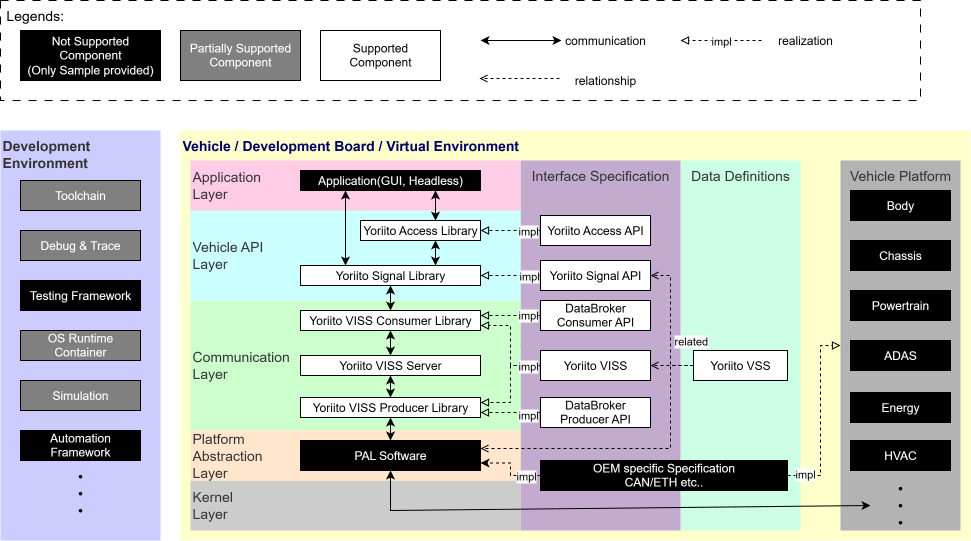
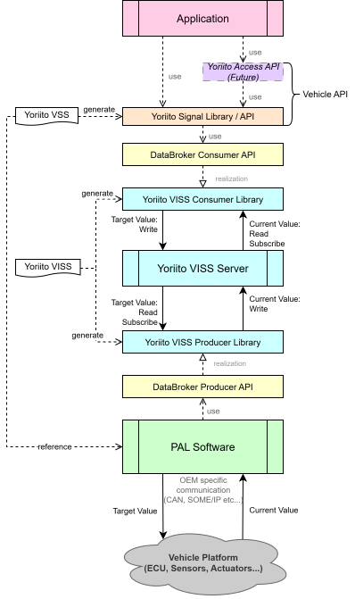
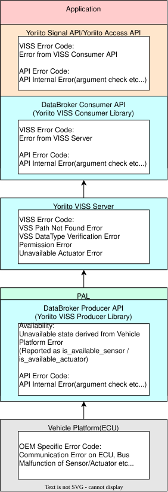
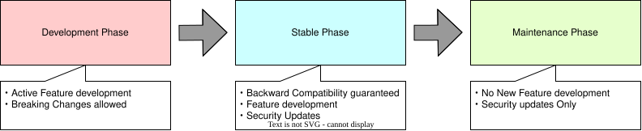
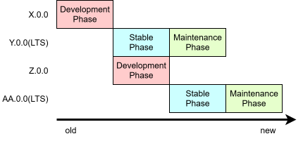

# Part1 Theory  

## 2. System Configuration/Scope/Versioning 📱🚗  

### 2-1. Introduction  

In this chapter, we explain the overall structure of the reference system that integrates the Vehicle API.

First, we clarify the scope covered by the Yoriito Vehicle API. Then, we describe an overview of the system architecture and the role of each component.

By understanding the roles and relationships of each component, it becomes easier to see where the implementations and code examples introduced in later chapters fit into the overall system.  

After that, we explain Capability, Availability, and error codes, which are important concepts when defining the behavior of the Vehicle API.  

We also describe the versioning of the overall Yoriito Vehicle API and each component, so that you can easily understand the future evolution and release plans of the Yoriito Vehicle API.

### 2-2. Scope  

<em>Figure: Yoriito Vehicle API Scope Definition</em>

The above diagram shows the scope that the Yoriito Vehicle API provides and supports, and the scope that each OEM or supplier implements and operates.  
The Yoriito Vehicle API provides interface definitions that form the boundaries between the layers of the system, data definitions used by each layer, and their implementations.  

The following interface definitions, data definitions, and components are developed and provided as part of the Yoriito Vehicle API:  

!!! info "Legend"
    - Interface definitions / data definitions  
        - Software components
  
- **Yoriito Access API**: A high-level API definition that focuses on usability from the application point of view, such as simplifying operations and data retrieval per use case.  
    - **Yoriito Access Library**: A shared library that implements the above.
- **Yoriito Signal API**: A low-level API definition for applications that provides access to vehicle signals (sensor values and actuator operations).  
    - **Yoriito Signal Library**: A shared library that implements the above.
- **DataBroker Consumer/Producer API**: An API definition for Vehicle API layer and PAL that provides access to the communication backend. This API definition is directly used by the Yoriito Signal API and is therefore specified by the Yoriito Signal API.  
    - **Yoriito VISS Consumer Library**: An API implementation for applications that provides access to the Yoriito VISS Server. As a reference implementation, a Kura client implementation is provided. This is also the implementation of Yoriito VISS described later.  
    - **Yoriito VISS Producer Library**: An API implementation for PAL that provides access to the Yoriito VISS Server. As a reference implementation, a Kura client implementation is provided. This is also the implementation of Yoriito VISS described later.
- **Yoriito VISS**: A complete set of protocol definitions (VISS message schemas) for accessing vehicle signals, extended and refined for the Yoriito Vehicle API.  
    - **Yoriito VISS Server**: A centralized server and data broker that manages the VSS data tree provided by Yoriito. As the reference implementation, Kura is provided.  
    - **Yoriito VISS Consumer Library, Yoriito VISS Producer Library**: As above.
- **Yoriito VSS**: A complete set of vehicle signal (VSS) definitions extended and refined for the Yoriito Vehicle API. OEMs/suppliers create their own vehicle-specific definitions based on this VSS definition.  
    - There is no dedicated software component that is a direct implementation. However, as data definitions, Yoriito VISS and the Yoriito Signal API use them. PAL software must reference Yoriito VSS to convert the data structures of the vehicle platform into data structures compliant with Yoriito VSS.

The Yoriito Signal API and Yoriito Access API are collectively called the **Vehicle API**.  

The following components are partially supported as part of the Yoriito Vehicle API:

- Toolchain: A complete toolchain to build and run components of the Yoriito Vehicle API. Provided as a reference.  
- Debug & Trace: Dedicated debugging tools are provided for some components.  
- OS Runtime/Container: A complete runtime environment where components of the Yoriito Vehicle API are integrated. Provided as a reference.  
- Simulation: Simulators that work in conjunction with components of the Yoriito Vehicle API. Provided as a reference.  

The following interface definitions, data definitions, components, and layers are not supported as part of the Yoriito Vehicle API:

- Application: Applications that run using the Vehicle API. Sample implementations are provided, but they are not part of the supported scope.  
- PAL (Platform Abstraction Layer) Software: An abstraction-layer software that absorbs differences in communication methods, ECU configurations, security/diagnostic interfaces, etc., specific to each OEM/vehicle model. Sample implementations are provided, but they are not part of the supported scope.  
- Testing Framework: A Vehicle-API-specific dedicated test framework is not provided. However, unit tests for each component and integration tests across components using general-purpose test frameworks are provided.  
- Automation Framework: CI/CD tools for projects using the Vehicle API are not provided. However, some of the CI/CD implementations used within the Yoriito Vehicle API are disclosed.  
- Definitions and recommended configurations of communication interfaces/data such as CAN signal definitions for vehicle platforms are not provided.  
- Vehicle Platform: The in-vehicle platform itself and ECU-specific implementations are not provided.  

**Summary**  
As described above, the Yoriito Vehicle API mainly provides the API layers that abstract access to vehicle signals. The concrete implementation of applications and the connection to vehicle platforms are handled by each company.  
Development environments and simulators that form an ecosystem for development using the Vehicle API are partially provided as reference.

### 2-3. System Architecture  

<em>Figure: Yoriito Vehicle API System Architecture</em>

The above diagram shows an overview of the system architecture in the Yoriito Vehicle API.  
In the Yoriito Vehicle API, the Yoriito VISS Server sits at the center of the system as a data hub, and applications and PAL exchange vehicle signal information through it.  

The **Yoriito VISS Server** acts as both a data hub and a data broker. It provides vehicle signal information supplied by PAL to applications, and also notifies PAL of actuator operation requests from applications.  

The DataBroker Consumer/Producer API and Yoriito VISS Consumer/Producer Library provide access methods to the Yoriito VISS Server.

- **DataBroker Consumer API**  
  Mainly an API used by the upper layers (application layer) to access the communication backend. It allows retrieval of current sensor values and setting of target values for actuators. This API is specified by the Yoriito Signal API and hides details of the communication backend. In principle, it is used as an internal implementation of the Yoriito Signal API described later, and is generally not used directly from applications.
- **DataBroker Producer API**  
  Mainly an API used by the lower layers (platform layer) to access the communication backend. It allows updating the current sensor values and retrieving target values for actuators. As with the Consumer API, it is specified by the Yoriito Signal API and hides details of the communication backend.
- **Yoriito VISS Consumer Library**  
  An implementation of the DataBroker Consumer API that provides the access method to the Yoriito VISS Server as the concrete communication backend. It wraps client-side implementations generated from the Yoriito VISS schema and provides them as an easy-to-use interface.
- **Yoriito VISS Producer Library**  
  An implementation of the DataBroker Producer API that provides the access method to the Yoriito VISS Server as the concrete communication backend. As with the Consumer Library, it wraps client-side implementations generated from the Yoriito VISS schema and provides them as an easy-to-use interface.

Because only the PAL implementation directly uses the DataBroker Producer API, the DataBroker Producer API is sometimes collectively referred to as the **PAL API**.  
Details of these APIs and VSS/VISS are explained in "[3. VSS/VISS](../03_VSS_VISS/03_vss_viss.md)".

The **Yoriito Signal API** further abstracts the DataBroker Consumer API to provide an API that can handle data as vehicle signals. As mentioned above, applications directly use the Yoriito Signal API; the DataBroker Consumer API is generally not used directly from applications.  
The Yoriito Signal API is generated from the complete set of vehicle signal definitions defined by Yoriito VSS and covers all signal definitions supported by the Yoriito Vehicle API.

The **Yoriito Access API** further abstracts the Yoriito Signal API and provides high-level APIs for vehicle operations and data access tailored to specific use cases. It is designed with an emphasis on ease of use and usability from the application side.

!!! note
    The Yoriito Access API is still under consideration and is not included in the current release.

**PAL (Platform Abstraction Layer)** is an abstraction layer that sits between the vehicle platform and the Yoriito VISS Server.  

The "vehicle platform" refers to the hardware/software base specific to each vehicle, including the ECUs, sensors, actuators installed in the vehicle, and the in-vehicle networks (CAN, CAN FD, LIN, SOME/IP, Automotive Ethernet, etc.) that connect them. The composition of the vehicle platform differs depending on the OEM (automaker), vehicle model, and even grade or options of the same model.  

For example, even for the same "vehicle speed" information, CAN IDs, byte positions, scaling factors, and update cycles can differ from vehicle to vehicle.

PAL absorbs these differences and communicates with the Yoriito VISS Server via the Yoriito VISS Producer API. The main responsibilities of PAL are as follows:

- **Acquisition and conversion of vehicle signals**:  
  PAL acquires signals from the vehicle platform, converts them into the format defined by Yoriito VSS, and supplies them to the Yoriito VISS Server via the Yoriito VISS Producer API.
- **Transfer of control requests**:  
  PAL receives target values set by applications via the Yoriito VISS Producer API, converts them into a format that the vehicle platform can understand, and transfers them.
- **Management of VSS nodes**:  
  Because the signals supported by the vehicle platform differ by vehicle, the definition of VSS nodes that are available on the Yoriito VISS Server must be created and managed per vehicle. This management is a responsibility of PAL and is done via configuration files and startup options for the Yoriito VISS Server or via functions provided by the Yoriito VISS Producer API.

By hiding vehicle-platform-specific details, PAL enables application developers to access vehicle signals via the Yoriito Signal API without being aware of differences between vehicle platforms.  
At the same time, PAL developers do not need to know the implementation of applications and can focus on connecting to the vehicle platform.  
This separation improves the portability of applications between different vehicles.  

**Summary**  
In this section, we explained the system architecture centered on the Vehicle API. The key points are as follows:

- The architecture of the Yoriito Vehicle API is a centralized structure with the Yoriito VISS Server as its core.  
- The Yoriito Vehicle API provides the DataBroker Consumer/Producer API and their implementations, the Yoriito VISS Consumer/Producer Library, as access methods to the Yoriito VISS Server. In addition, for applications, it provides the Yoriito Signal API, which abstracts these and enables access based on vehicle signals.  
- Application developers use the Yoriito Signal API to obtain vehicle signals from the Yoriito VISS Server and issue actuator operation requests to the Yoriito VISS Server.  
- PAL developers use the DataBroker Producer API (Yoriito VISS Producer Library) to provide vehicle signals to the Yoriito VISS Server and receive actuator operation requests notified by the Yoriito VISS Server.

For more detailed design information, see [Yoriito Vehicle API - Architecture Overview](../../design/architecture_overview.md).

### 2-4. Development and Execution Environment  

In this section, we explain the development environment and runtime environment required to develop and run the Vehicle API, and to follow this tutorial.  
We describe the supported OSs and tools. Specific installation steps and detailed configuration of each tool are not covered here.

#### 2-4-1. Recommended Development Environment  

##### Machine specifications  

As a development environment, we recommend the following machine specifications:

- CPU: 4 cores / 8 threads or more (x86_64 architecture)  
- RAM: 16 GB or more  

##### OS  

- Ubuntu 24.04 LTS  

#### 2-4-2. Supported Runtime Environment  

The Yoriito Vehicle API supports the following runtime environment:

- **Yocto Linux on Raspberry Pi 4B**  
    - Architecture: AArch64 (64-bit)  
    - Yocto version: scarthgap  

#### 2-4-3. Provided Development Environment  

In addition to the above runtime environment, a **devcontainer** is provided as a development environment.

- **devcontainer**  
    - Architecture: x86_64 (64-bit)

The devcontainer includes the SDKs and toolchains required to build and run the Vehicle API in advance and provides a unified development environment for all developers.  

For concrete procedures to set up the development environment, see [here](../04_environment_setup/04_environment_setup.md).

### 2-5. System Behavior  

In this section, we explain three important concepts for defining the behavior of the Vehicle API: **Capability**, **Availability**, and **error codes**.  
By clearly defining these concepts as a "contract", application developers can handle differences between vehicle models and grades, and temporary unavailability, in a consistent way.

#### 2-5-1. Capability and Availability  

In the Vehicle API, we use two concepts, **Capability** and **Availability**, to expose differences between vehicle models/grades and temporary unavailability, not hide them, and express them as a common "contract" for applications.

- **Capability**: Indicates whether an equipment/function physically exists (permanent availability).  
    - Basically does not change (except for additions of equipment or functions, e.g., by OTA).  
- **Availability**: Indicates whether the equipment/function is currently usable (temporary availability).  
    - Changes dynamically depending on the vehicle state.

By distinguishing these two, applications can clearly determine whether:

- "This vehicle does not have the equipment/function at all" (Capability), or  
- "The equipment/function exists, but is currently unusable / conditions are not met" (Availability).

!!! note
    The specifications of Capability and Availability are still under discussion and may change in future versions.

#### 2-5-2. Capability (Presence/Absence of Equipment/Function)  

Capability represents whether a piece of equipment/function physically and permanently exists. Even when certain equipment is present, there may be differences in functions by equipment; therefore, Capability is managed per signal.  

Capability is expressed as an error code (`ERROR_NOT_FOUND`) that can be obtained via the Vehicle API.  

Applications can determine the presence or absence of Capability by calling the APIs related to the equipment/function they want to use.

For example, if you want to operate the lumbar support function of a seat and adjust the lumbar support height, you can check whether the function/equipment exists by calling the API corresponding to the height of the lumbar support of the relevant seat and seeing whether the result returns an `ERROR_NOT_FOUND` error.  

For details of how to call each API and error codes, see the Vehicle API reference document.

To allow applications to correctly recognize Capability, OEMs must predefine the VSS tree for each vehicle and remove VSS nodes that do not exist as equipment/functions.

!!! note
    For VSS/VISS, see "[3. Introduction to VSS/VISS](../03_VSS_VISS/03_vss_viss.md)".

Typical use cases of Capability include:

- Hide the UI related to a function when a vehicle does not have that function, e.g., when the vehicle does not have a seat lumbar support function.  
- In a grade that does not have a sunroof, do not display the menu for sunroof control.

#### 2-5-3. Availability (Temporary Availability of Equipment/Function)  

Availability represents whether an equipment/function is currently usable (whether the conditions are satisfied), as a temporary, condition-dependent state.  

Availability is expressed as a boolean (two values: true/false).  

Each value means:

- `true`: The equipment/function is currently available.  
- `false`: The equipment/function exists but is currently unusable (conditions not met, temporary failure, etc.).

Availability changes in response to various factors, such as:

- Startup/shutdown state of vehicle systems/ECUs.  
- Driving state of the vehicle (e.g., functions only operable while stopped).  
- Shift range (e.g., functions valid only in P range).  
- Door open/close state.  
- Restrictions based on safety concepts.  
- Temporary failure of sensors/actuators, system failures.  
- High-load state of the system.

PAL monitors the vehicle state and updates Availability through the DataBroker Producer API (Yoriito VISS Producer Library) to reflect it in the Yoriito VISS Server.

Typical use cases of Availability include:

- Make applications wait until the system is fully started.  
- Gray out door open/close UI while the vehicle is running.

!!! warning "Current implementation"
    Availability is expressed as data within VISS.

    ???+ note
        For VSS/VISS, see "[3. VSS/VISS](../03_VSS_VISS/03_vss_viss.md)".

    In the data type `DataPointCurrent`, which expresses signal data exchanged according to VISS,  
    members `is_available_actuator` and `is_available_sensor` are defined to represent Availability.

    `DataPointCurrent` consists of the following members:

    - `storedTimestamp`: The timestamp at which the signal data was stored in the Yoriito VISS Server.  
    - `value`: The signal data.  
    - `producedTimestamp`: The timestamp at which the signal data was generated.  
    - `is_available_actuator`: Availability as an actuator.  
    - `is_available_sensor`: Availability as a sensor.

    If you want to check Availability as an actuator, refer to the value of `is_available_actuator`.  
    If you want to check Availability as a sensor, refer to the value of `is_available_sensor`.

    In addition, when an application issues a `Set` request to a signal whose `is_available_actuator` is `false`, the Yoriito VISS Server rejects the request with `ERROR_SERVICE_UNAVAILABLE`.  
    Therefore, applications do not need to check Availability before every API call; they can simply execute the API call and handle the error when the signal is unavailable.

#### 2-5-4. Conditions Under Which Availability Changes  

Availability changes according to various factors. PAL monitors the vehicle state and updates Availability according to these conditions.  

The conditions under which Availability changes differ by VSS node.

!!! note
    Currently, there is no clear definition of the conditions under which each VSS node should change its Availability.  

In a future update, clear definitions will be added for the conditions under which PAL should update Availability. This will include the minimum set of conditions that must be supported depending on the capabilities of the vehicle platform (e.g., when the vehicle system starts, Availability should be set to true), such as cases where the vehicle platform does not have the capability to finely track Availability for specific vehicle signals.

#### 2-5-5. Error Codes  

The Yoriito Vehicle API aims to organize errors that tend to be scattered across implementations and vehicle differences from a common perspective, and to simplify error handling on the application side.  

The architecture of the Yoriito Vehicle API consists of multiple components, such as applications, the Yoriito VISS Server, and PAL. These components use a consistent set of error code definitions.  

This makes error handling between components consistent and simplifies debugging because developers of each component work with the same set of error codes.

##### Error Code Categories

Error codes are broadly classified into two categories:

- **VISS**: Errors that occur in communication with the Yoriito VISS Server. These are HTTP status–code-based errors conforming to the COVESA VISS v3 specification.  
- **API**: Errors that are completed inside the API layer, such as the Yoriito Signal API. These are error codes based on Linux `errno`.

**VISS-category error codes**  

Errors that occur in communication with the VISS Server conform to the COVESA VISS v3 specification with some extensions.

- **ERROR_BAD_REQUEST (400)**: The request is invalid.  
- **ERROR_UNAUTHORIZED (401)**: The access token is invalid.  
- **ERROR_FORBIDDEN (403)**: The server refused to execute the request.  
- **ERROR_NOT_FOUND (404)**: The requested data was not found.  
- **ERROR_REQUEST_TIMEOUT (408)**: Subscribe duration limit exceeded.  
- **ERROR_UNSPECIFIED (409)**: Parameter is unspecified.  
- **ERROR_TOO_MANY_REQUESTS (429)**: Rate limiting due to too many requests.  
- **ERROR_INTERNAL_SERVER_ERROR (500)**: An internal error occurred in the server.  
- **ERROR_BAD_GATEWAY (502)**: The response from the upstream server is invalid.  
- **ERROR_SERVICE_UNAVAILABLE (503)**: The server is temporarily unable to process the request.  
- **ERROR_GATEWAY_TIMEOUT (504)**: The response from the upstream server timed out.

**API-category error codes**  

Errors that are completed within the API are defined based on Linux `errno`.

- **ERROR_PERM (1)**: Insufficient permission for the operation.  
- **ERROR_NOMEM (12)**: There is not enough free memory.  
- **ERROR_ACCES (13)**: No permission.  
- **ERROR_INVAL (22)**: Invalid argument.  
- **ERROR_NODATA (61)**: Data does not exist.  
- **ERROR_BADMSG (74)**: Bad message.  
- **ERROR_TIMEDOUT (110)**: The operation timed out.  
- **ERROR_CONNREFUSED (111)**: Connection refused.  
- **ERROR_CANCELED (125)**: Operation was canceled.  
- **ERROR_UNAVAILABLE (1000)**: Data is unavailable (Availability is false).  
- **ERROR_UNSUBSCRIBE (1001)**: The subscription to be unsubscribed does not exist.

#### 2-5-6. Error Detection and Responsibilities per Layer  

Errors are detected at each layer of the system and finally propagated to the application. Responsibilities of each layer are as follows.

##### Access API / Signal API / DataBroker Consumer API

Applications basically only need to be aware of the errors returned by the Access API / Signal API. The Access API / Signal API maps and returns the following errors as part of a common error vocabulary:

- Errors detected inside the Access API / Signal API (argument checks, out-of-memory, etc.).  
- Errors detected inside the implementation of the DataBroker Consumer API (argument checks, out-of-memory, etc.).  
- Errors returned by the VISS Server.

##### VISS Server

The VISS Server mainly detects errors related to the VSS tree and the protocol. It also propagates errors notified by PAL to the upper layers.

- Errors in resolving VSS paths.  
- Type mismatch.  
- Insufficient permissions.  
- Other operations that are not allowed on the VSS tree.  
- Errors propagated from PAL.

##### PAL / DataBroker Producer API

PAL detects errors that originate in the state, communication, and equipment state of the real vehicle or simulator.

- Errors detected inside the implementation of the DataBroker Producer API (argument checks, out-of-memory, etc.).  
- Communication errors of ECUs and buses.  
- Sensor failures, actuator failures.  
- Errors related to Capability/Availability (e.g., below safety thresholds, priority conflicts, invocation limits, battery conditions).

These conditions are conveyed as the Availability (`is_available_sensor` / `is_available_actuator`) defined by the DataBroker Producer API and propagated through the Yoriito VISS Server to the Yoriito Signal API and the application.

The figure summarizing the error handling flow at each layer is as follows:  

<em>Figure: Error Propagation</em>

By aligning a common error vocabulary vertically across layers, application/PAL developers can easily understand "what happened and where," and implement consistent exception handling.

##### Consistency of Behavior Between Simulator and Real Vehicle

The "contracts" of the Access API, Signal API, error vocabulary, Capability, and Availability should be implemented identically for both real-vehicle environments and simulator environments.  

This allows the behavior seen from the upper layers (Signal API, applications) to remain consistent even if the PAL implementation is swapped, and yields the following benefits:

- Applications developed and tested in a simulator environment can be moved to a real-vehicle environment as is.  
- A common test suite can detect and correct behavioral differences between PAL implementations.  
- Application developers can focus on development without being aware of differences in runtime environments.

#### 2-5-7. Summary  

In this section, we explained three important concepts for defining the behavior of the Vehicle API.

- **Capability**: Represents whether equipment/functions physically exist. It expresses permanent differences between vehicle models and grades.  
- **Availability**: Represents whether functions are currently usable. It expresses dynamic differences due to vehicle states and temporary failures.  
- **Error codes**: Represent reasons for API call failures using a common vocabulary and enable consistent error handling across layers.

By clearly defining these concepts as a "contract," we gain the following benefits.

##### For application developers

- Access vehicle functions in a unified way without being aware of differences between vehicle models and grades.  
- Clearly distinguish between "the function does not exist" and "the function is temporarily unavailable" and provide appropriate UI and error messages.  
- Implement consistent exception handling using a common error vocabulary.  
- Improve development and testing efficiency by running the same code in both simulator and real-vehicle environments.

##### For PAL developers

- By following the common framework of Capability / Availability / error codes, responsibility separation with upper layers becomes clear.  
- While hiding details specific to the vehicle platform, PAL can still convey the necessary information to the upper layers.  
- This leads to a design that can more easily cope with future feature extensions and changes in vehicle platforms.

Note that the specifications of Capability and Availability are still under discussion, and the implementation method may change in future versions. For the latest specifications, see the Vehicle API reference document.

### 2-6. Release Cycle and Versioning

In this section, we describe how deliverables of the Yoriito Vehicle API are released and how they are versioned.

#### 2-6-1. Versioning

The version of the Yoriito Vehicle API is managed at two levels.

##### Version of the entire project

This is the version of the Yoriito Vehicle API as a whole.  
It is a version that spans multiple components, such as the Yoriito Access API, Yoriito Signal API, Yoriito VISS Server, and Yoriito VSS.  

When users indicate "which release they are using," they refer to this version.  

For example, it is represented as "Yoriito Vehicle API 0.3.0".

##### Version of each component

The Yoriito Vehicle API consists of multiple components, each with its own version.  
Versions of individual components are referenced when developers track the change history of a specific component or check compatibility.  

Both project-level versioning and per-component versioning adopt **semantic versioning (MAJOR.MINOR.PATCH)**.

In addition, the following components, which are results of integration of multiple components, are not assigned their own component version but share the project-wide version:

- Yocto recipes and the Yocto Linux OS images and Yocto SDKs generated from them.  
- Project-wide documents (including this document).  

!!! warning
    - Currently, the Yoriito Vehicle API is in the 0.X.Y phase, and backward compatibility may not be maintained as specifications and implementations change.  
    - This period is positioned as a phase to stabilize specifications while incorporating feedback.  
    - From version 1.0.0 onward, the handling of major versions and the approach to compatibility are planned to become stricter.

#### 2-6-2. Release Cycle

In principle, an OSS release is made every six months.  

In addition, if critical bug fixes or security responses are needed, PATCH releases may be made without waiting for a regular release.  

The release cycle may change in the future.

##### Development Phases and Transition of Major Versions

Development of the Yoriito Vehicle API consists of three phases, as shown in the following diagram:  

<em>Figure: Development Phase</em>

1. **Development Phase**: A period in which active development of new features takes place. During this period, breaking changes may be introduced.  
2. **Stable Phase**: A period in which backward compatibility is guaranteed. New features and security updates are provided, but no changes that break backward compatibility are made.  
3. **Maintenance Phase**: A period in which no new feature development is done and only security updates and bug fixes are provided.

As shown in the figure below, there are two types of major versions: **major versions that only have a Development Phase** and **major versions that only have Stable and Maintenance Phases**.  

<em>Figure: Relationship between Development Phases and Major Versions</em>

New feature development is carried out in a major version (X.0.0) that has a Development Phase.

Once this major version has become sufficiently stable, the next major version (Y.0.0) is released.

This major version (Y.0.0) is positioned as an **LTS (Long-Term Support) release**, which is a major version composed of the Stable and Maintenance Phases. An LTS release is supported for multiple years.  

In parallel with the LTS release, the Development Phase for the next major version starts. When an LTS release transitions to the Maintenance Phase, **the next LTS release must already be available**.  

Users need to consider migrating to the next major version when their current major version enters the Maintenance Phase.
