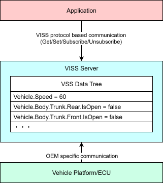
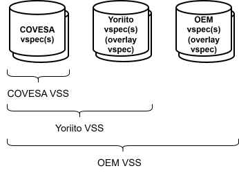
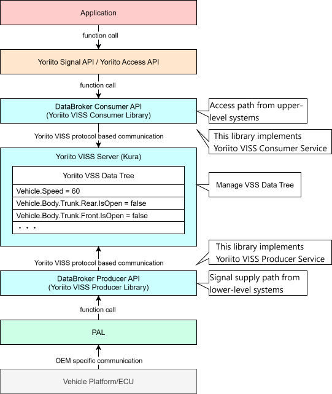

# Part1 Theory

## 3. Introduction to VSS/VISS 🚗

### 3-1. Introduction

In this section, we explain VSS and VISS, which form the foundation of the Yoriito Vehicle API.
These are standard specifications for vehicle data defined by COVESA (Connected Vehicle Systems Alliance), and the Vehicle API is built on top of them.

By understanding VSS / VISS, the goal of this section is to help you better understand the design intent of the Vehicle API and how it differs from COVESA VSS/VISS.

### 3-2. Background

Modern vehicles have thousands of signals (sensor values, actuator states, vehicle attributes, etc.). Traditionally, the names, data formats, and access methods of these signals have differed between OEMs (automakers) and even between vehicle models.

This has caused the following issues:

- **Lack of application portability:**  
  Applications developed for one vehicle model need major modifications to run on another model or on vehicles from another OEM.  
- **Increased development cost:**  
  For each vehicle model, developers have to research and implement signal meanings and access methods.  
- **Fragmented ecosystem:**  
  It is difficult for third-party developers to build applications for vehicles.  

To solve these issues, COVESA is standardizing the data model for vehicle signals (VSS) and the access protocol (VISS).

### 3-3. COVESA VSS/VISS

#### 3-3-1. What is VSS (Vehicle Signal Specification)?

VSS is a standard specification of a data model that defines the "semantics and structure" of vehicle signals.

##### Overview

VSS consists of the following two elements:

1. **Syntax rules**: Rules for how to define vehicle signals  
2. **Standard catalog**: A collection of definitions for common vehicle signals  

The standard catalog predefines signals that are common to many vehicles, such as vehicle speed, engine RPM, door open/close states, and so on.

In the Vehicle API, based on COVESA VSS, we add necessary signal definitions, remove unnecessary/duplicate signals, and modify existing ones to provide a Yoriito Vehicle API–specific VSS data tree.

##### Tree structure

In VSS, vehicle signals are expressed as a hierarchical tree structure. The root node is `Vehicle`, under which branches like `Powertrain`, `Chassis`, and `Body` follow.

```text
Vehicle
├── Speed                          # Vehicle speed
├── Powertrain
│   └── TractionBattery
│       └── StateOfCharge
│           └── CurrentEnergy      # Battery energy remaining
├── Chassis
│   └── Accelerator
│       └── PedalPosition          # Accelerator pedal position
└── Body
    ├── Lights
    │   └── Beam
    │       └── Low
    │           └── IsOn           # Low-beam headlamp state
    └── Trunk
        └── Rear
            └── IsOpen             # Trunk open/close state
```

##### Signal types

In VSS, signals are classified into the following three types:

| Type         | Description                                               | Examples                                              |
| ------------ | --------------------------------------------------------- | ----------------------------------------------------- |
| **Sensor**   | Read-only signals representing current state from sensors | Vehicle speed, outside temperature, SoC              |
| **Actuator** | Read/write signals representing controllable state        | Door lock, window position, seat position            |
| **Attribute**| Immutable signals representing static attributes of the vehicle | VIN, max power, fuel type                      |

For Actuators, the state of a control target is represented by two values:

- **Current Value:** The current state of the control target

- **Target Value:** The future state the control target should reach

For example, when changing the seat position from 0 to 100, the **Target Value** becomes 100 immediately, but the **Current Value** changes gradually until the mechanical movement completes. During this period, the two values differ.

> For more details on VSS, see the official documents below:  
> 
> * [Overview](https://covesa.github.io/vehicle_signal_specification/introduction/overview/)  
> * [Sensors, Actuators and Attributes](https://covesa.github.io/vehicle_signal_specification/introduction/sensors_actuators_attributes/)  
> * [GitHub – COVESA VSS](https://github.com/COVESA/vehicle_signal_specification)  

#### 3-3-2. What is VISS (Vehicle Information Service Specification)? 

VISS is a protocol specification for accessing the signal tree defined by VSS.  
While VSS defines "what data exists," VISS defines "how to access that data."

##### Overview

Using VISS, applications can perform the following unified operations on signals in the VSS tree:

| Operation | Description |
| --- | --- |
| **Read** | Retrieve the current value of a specified signal once |
| **Subscribe** | Receive a notification whenever the value of a specified signal changes |
| **Write** | Write a value to a specified signal (mainly used to set actuator Target Values) |
| **Metadata** | Retrieve meta-information about signals (data type, unit, description, etc.) |

A VISS Server holds information about the VSS tree and processes these operations in response to client requests.

##### Transport protocols

VISS supports multiple transport protocols; supported protocols differ by version.

| Version | Supported protocols |
| --- | --- |
| VISS v1 | WebSocket |
| VISS v2 | WebSocket, HTTP, MQTT |
| VISS v3 | WebSocket, HTTP, MQTT, gRPC |

The Yoriito Vehicle API adopts **gRPC-based VISS**, focusing on performance and type safety.

##### Error responses

In VISS, error responses consist of the following three elements:

| Element | Description |
| --- | --- |
| **Error code (number)** | Numeric value conforming to HTTP status codes (400, 404, 503, etc.) |
| **Error reason (reason)** | Identifier indicating the error type (e.g., `bad_request`, `not_found`) |
| **Error description (description)** | Human-readable detailed error description |

This structure is defined in COVESA VISS v3.

> For more details on VISS, see the official documents below:
> 
> * [Overview](https://covesa.global/project/vehicle-information-service-specification/)
> * [GitHub – COVESA VISS](https://github.com/COVESA/vehicle-information-service-specification)
> * [VISS and related standards](https://covesa.github.io/vehicle_signal_specification/ecosystem/standards/index.html)

#### 3-3-3. Relationship between VSS and VISS

VSS and VISS have different roles but are used together.



<p align="center"><em>Figure: COVESA VISS Overview</em></p>

- **VSS**: Defines the "name," "meaning," and "structure" of signals (data model)

- **VISS**: Defines "how to access" those signals (protocol)

By separating these, the data model and access method can evolve independently.


### 3-4. Yoriito VSS/VISS

#### 3-4-1. About Yoriito VSS

##### Role of VSS in the Yoriito Vehicle API (Yoriito VSS) 

In the Yoriito Vehicle API, VSS is positioned as a "common data model / signal catalog" for handling vehicle signals in a unified way.

Based on the generic vehicle signal tree defined by COVESA VSS, Yoriito VSS performs additions of necessary signals, removal of unnecessary signals, and normalization (cleanup) of meanings and structures for the Vehicle API.

##### How to obtain and inspect Yoriito VSS

Clone the following repository: https://github.com/yoriito/yoriito-vss.git

Like COVESA VSS, Yoriito VSS can be exported in tree or CSV format using the VSS tool.
In particular, CSV format is highly readable when you need to check signal units and descriptions.

Example command to export Yoriito VSS in CSV format:

```shell
vspec export csv \
  --vspec ./vehicle_signal_specification/spec/VehicleSignalSpecification.vspec \
  $(find ./vss -name '*.vspec' -exec echo --overlays {} \;) \
  --output Yoriito_vss_v5.0.csv
```
For details on how to use the VSS tool, see: https://covesa.github.io/vehicle_signal_specification/ecosystem/tools/index.html

##### Differences between COVESA VSS and Yoriito VSS

Yoriito VSS is COVESA VSS with normalization (additions, modifications, deletions of signals) applied.  
"Normalization" in Yoriito VSS means organizing each signal from consistent perspectives. Examples include:  

- The data model provides OEM- and vehicle-model–independent definitions.  
- To clarify containment relationships, nodes are expressed in the order:
equipment → (sub-equipment → …) → function → (sub-function → …) → properties.  
- When the data model handles coordinate information, it uses right-hand coordinate system, Z-up, X-front, and explicitly documents this in the specification so API users can use it without confusion.  
- The data model does not define internal states for asynchronous waiting.  
- When a data value is outside the defined range, use Other; when the value is not yet determined, use Unknown.  
- The data model is not defined by implementation methods or by use cases; instead, it is defined for equipment and provided functions.  
- Information that can be derived from other data models is not defined as a separate data model.  
    - Example: `StateOfCharge.CurrentEnergy` can be calculated as `StateOfCharge.Current × TractionBattery.NetCapacity`, so `StateOfCharge.CurrentEnergy` is removed.  

##### VSS operation at OEMs 

As described above, Yoriito VSS is COVESA VSS normalized for the Vehicle API, and Vehicle API users can reference and set vehicle signals defined in Yoriito VSS.

In the same way that Yoriito VSS extends [COVESA VSS using Overlay](https://covesa.github.io/vehicle_signal_specification/extensions/overlay/index.html),
each OEM that uses Yoriito VSS can extend it to create its own OEM VSS.

VSS can be overlaid in the order: COVESA → Yoriito → OEM.



The defined VSS signals and their metadata are held by the Yoriito VISS Server, so you must provide VSS information to the Yoriito VISS Server.

The Yoriito VISS Server supports two timing options to configure VSS information:

- **Static configuration:**  
  Specify VSS files at Yoriito VISS Server startup.  
- **Dynamic configuration:**  
  Configure VSS via the Yoriito VISS Producer Library after the Yoriito VISS Server has started.  

When overlaying the VSS tree, in addition to complying with the VSS specification, you must follow constraints unique to the Yoriito Vehicle API. These constraints are required so that the Yoriito VISS Server and Vehicle API libraries function correctly.

For example, changing a signal type (e.g., from integer to string) is prohibited because it affects data operations inside the Yoriito VISS Server and Vehicle API libraries.

Targets of VSS overlays are broadly classified as follows:

- Signal definitions: VSS node definitions. Overlay can be used to add new signals or remove existing signals.  
- Metadata: Metadata definitions associated with each VSS node definition. Overlaying existing signal metadata can be used to change default values, etc.  
- Instances: Mechanisms to generate multiple sets of VSS nodes that share the same VSS tree structure, such as doors. For example, you can overlay the number of doors or how positions are specified (`Row1`, `DriverSide`, etc.).  

For each of these elements, whether and how overlay is allowed is defined as follows.

| **Target** | **Overlay allowed?** |
| --- | --- |
| **Signals** |  |
| Add new signal | Allowed |
| Delete existing signal | Allowed |
| **Metadata** |  |
| Change value of Existing Metadata* |  |
| &nbsp;&nbsp;&nbsp;&nbsp;`type` | Prohibited |
| &nbsp;&nbsp;&nbsp;&nbsp;`datatype` | Prohibited |
| &nbsp;&nbsp;&nbsp;&nbsp;`comment` | Prohibited |
| &nbsp;&nbsp;&nbsp;&nbsp;`min` | Allowed |
| &nbsp;&nbsp;&nbsp;&nbsp;`max` | Allowed |
| &nbsp;&nbsp;&nbsp;&nbsp;`unit` | Prohibited |
| &nbsp;&nbsp;&nbsp;&nbsp;`pattern` | Prohibited |
| &nbsp;&nbsp;&nbsp;&nbsp;`default` | Allowed |
| &nbsp;&nbsp;&nbsp;&nbsp;`allowed` | Allowed |
| &nbsp;&nbsp;&nbsp;&nbsp;`arraysize` | Prohibited |
| Add new metadata kinds | Allowed |
| Delete existing metadata kinds | Prohibited |
| **Instances** |  |
| Add new instance dimension | Prohibited |
| Delete existing instance dimension | Prohibited |
| Add new instance element index | Allowed |
| Delete existing instance element index | Allowed |
| Add new instance element name | Prohibited |
| Delete existing instance element name | Allowed |

* https://covesa.github.io/vehicle_signal_specification/rule_set/data_entry/sensor_actuator/index.html#optional-data-entry-attributes

As long as changes follow the above rules, the Yoriito VISS Server and Vehicle API libraries will function correctly.
For overlays that do not follow these rules, the Yoriito Vehicle API cannot guarantee correct behavior of its deliverables, so users must handle them on their own.

### 3-4-2. About Yoriito VISS

In the architecture of the Yoriito Vehicle API, the Yoriito VISS Server (kura) plays a central role. It manages the VSS tree and acts as a "data hub" connecting the upper layers (Yoriito Signal API / applications) and the lower layers (PAL / vehicle platform).



<p align="center"><em>Figure: Yoriito VISS Overview</em></p>

Access from the upper layers is mainly via the **DataBroker Consumer API**, and signal supply from the lower layers is via the **DataBroker Producer API**.

Behind these abstract interfaces, the Yoriito VISS Consumer/Producer Libraries communicate with the VISS Server using the VISS protocol. Thanks to this structure:

Application developers and PAL developers can each use APIs suited to their responsibilities.

They do not need to care about details of the communication backend.

##### Relationship among VSS / VISS / Yoriito Signal API

The relationship between the elements that make up the Yoriito Vehicle API can be summarized as follows.

| Element | Role |
| --- | --- |
| **Yoriito VSS** | Data model defining the "meaning and structure" of vehicle signals. Specifies tree structure, data types, units, etc. |
| **Yoriito VISS** | Protocol and message schema for manipulating the VSS tree. In the Yoriito Vehicle API, this is defined using gRPC. It consists of two services: Consumer Service and Producer Service (see below). |
| **Yoriito VISS Consumer / Producer Library** | Client libraries that wrap the VISS protocol (Consumer/Producer Service). They implement the DataBroker Consumer/Producer API and allow developers to avoid using gRPC directly. |
| **DataBroker Consumer / Producer API** | Abstract interface that hides details of communication backend access. Yoriito Signal API and PAL Software use this interface to communicate, without depending on details of the backend (such as VISS). |
| **Yoriito Signal API** | Low-level API for application developers. Internally accesses the Yoriito VISS Server via the DataBroker Consumer API. |
| **Yoriito Access API** | High-level API for application developers. |

Application developers use the Yoriito Access API and Yoriito Signal API to access vehicle signals. PAL developers supply vehicle-side signals to the Yoriito VISS Server via the DataBroker Producer API. In both cases, communication with the VISS Server is performed by the Yoriito VISS Consumer/Producer Library behind the scenes.

##### Differences between COVESA VISS v3 and Yoriito VISS

Yoriito VISS is based on COVESA VISS v3 but introduces some changes and extensions. The main differences are summarized below.

| Aspect | COVESA VISS v3 | Yoriito VISS |
| --- | --- | --- |
| Interface toward PAL/vehicle platform | Not clearly defined | Application-facing and PAL/vehicle-platform-facing interfaces are separated and defined as Consumer/Producer Services |
| Transport | WebSocket, HTTP, MQTT are mandatory; gRPC is optional | Specialized for gRPC |
| Service structure | Single service (Get, Set, Subscribe, Unsubscribe) handles both Current and Target values | Access separation by Consumer/Producer Services; some RPC methods are added |
| Data representation | JSON Schema based | Strongly typed Protocol Buffers |

More details are given below.

###### Separation of responsibilities via Consumer / Producer Services

<u>Consumer Service</u>  

The Consumer Service is a VISS service definition for applications and upper-layer middleware to access the VSS tree.

- Read / Subscribe for Current Values  
- Write of Target Values  

It provides the operations needed for typical application development, such as "referencing vehicle state" and "issuing control requests."  

The VISS Consumer Library provides the client implementation of this service and functions as the implementation of the DataBroker Consumer API.

<u>Producer Service</u>  
The Producer Service is a VISS service definition for PAL and the vehicle platform to provide signals to the VSS tree.

- Write of Current Values  
- Read / Subscribe for Target Values  

It reflects actual values obtained from ECUs and sensors into the VISS Server and receives control requests (Target Values) from applications to pass them to the vehicle side.

The VISS Producer Library provides the client implementation of this service and functions as the implementation of the DataBroker Producer API.

<u>Significance of the separation</u>  
This separation brings the following benefits:

- **Clear responsibility boundaries**:  
  Clarifies "who can update vehicle signals" and "through which paths updates are allowed" in system design.  
- **Security**:  
  Prevents applications from directly overwriting Current Values, protecting the consistency of vehicle signals.  
- **Independent development**:   
  Application developers and PAL developers each use only the APIs corresponding to their responsibilities.  
- **Clarified PAL specifications and improved reusability**:   
  By providing standardized interfaces not only for applications but also for PAL, PAL responsibilities become clearer and PAL can be reused more easily.  

###### Transport protocol

COVESA VISS v3 defines WebSocket and HTTP as mandatory, and MQTT and gRPC as optional.  
In contrast, Yoriito VISS adopts **only gRPC** as the transport protocol.

Reasons for choosing gRPC include:

- **Performance**:  
  Smaller data size and faster parsing compared to JSON thanks to binary serialization with Protocol Buffers.  
- **Type safety**:  
  Schema defined in `.proto` files enables compile-time type checking.  
- **Code generation**:  
  Client/server code for multiple languages can be auto-generated, improving development efficiency.  
- **Streaming**:  
  Server-streaming RPC makes it natural to implement Subscribe functionality.  

###### Service structure

In COVESA VISS v3, a single service provides the following actions:

- `Get`: Get signal values  
- `Set`: Set signal values  
- `Subscribe`: Start subscription of signal values  
- `Unsubscribe`: Cancel subscription  

Yoriito VISS splits this into **Consumer Service** and **Producer Service**, and clearly separates Current Values from Target Values.

##### Consumer Service (`yoriito.viss.v1.consumer.VISS`)

| RPC method        | Description                 | Correspondence to COVESA VISS v3                  |
| ----------------- | --------------------------- | ------------------------------------------------- |
| `GetCurrent`      | Get Current Values          | Part of `Get`                                     |
| `SetTarget`       | Set Target Values           | Part of `Set`                                     |
| `SubscribeCurrent`| Subscribe to Current Values | Part of `Subscribe`                               |
| `Unsubscribe`     | Cancel subscription         | `Unsubscribe`                                     |
| `Inspect`         | Get metadata                | Part of `Get` (via `MetadataFilter`)              |

##### Producer Service (`yoriito.viss.v1.producer.VISS`)

| RPC method        | Description                      | Correspondence to COVESA VISS v3                  |
| ----------------- | -------------------------------- | ------------------------------------------------- |
| `GetTarget`       | Get Target Values                | Part of `Get`                                     |
| `SetCurrent`      | Set Current Values               | Part of `Set`                                     |
| `SubscribeTarget` | Subscribe to Target Values       | Part of `Subscribe`                               |
| `Unsubscribe`     | Cancel subscription              | `Unsubscribe`                                     |
| `Inspect`         | Get metadata                     | Part of `Get` (via `MetadataFilter`)              |
| `Define`          | Add VSS node definitions at runtime | **Yoriito VISS specific**                      |
| `Delete`          | Delete VSS node definitions      | **Yoriito VISS specific**                         |

###### Yoriito VISS-specific extensions: Inspect / Define / Delete

Yoriito VISS introduces the following RPC methods that do not exist in COVESA VISS v3:

- **Inspect**:   
  Retrieves metadata of VSS nodes (data type, unit, description, etc.). Available in both Consumer and Producer Services.  
- **Define**:  
  Adds VSS node definitions at runtime. Used by PAL to register needed signals in the VISS Server according to the vehicle platform configuration (Producer Service only).  
- **Delete**:  
  Deletes defined VSS nodes (Producer Service only).  

With Define / Delete, it becomes possible to modify static VSS definitions files on already released vehicles after deployment.  
This allows flexible construction of the VSS tree as vehicles and software evolve.

> Note: Define/Delete are currently under development and not yet available.

###### Message schema differences

COVESA VISS v3 defines message formats using JSON Schema. Yoriito VISS defines them with Protocol Buffers (`.proto` files), with characteristics such as:

##### Strict definition of data types

In Yoriito VISS, `ValueType` corresponding to VSS data types is defined using Protocol Buffers, `oneof`:

```proto
message ValueType {
  oneof value_type {
    string string = 11;
    bool bool = 12;
    sint32 int8 = 13;
    sint32 int16 = 14;
    sint32 int32 = 15;
    sint64 int64 = 16;
    uint32 uint8 = 17;
    // ... other types as well
    ValueObject value_object = 35;  // corresponds to VSS struct
  }
}
```

###### Separation of Current and Target

`DataPackage`, the data structure for storing VSS signal data, is also split between Current and Target.  
This allows control of which data can be accessed by applications and PAL:

- `DataPackagesCurrent` / `DataPointCurrent`: For Current Values (includes timestamps and Availability information)  
- `DataPackagesTarget` / `DataPointTarget`: For Target Values  

###### Simplified metadata

For some metadata attributes in COVESA VSS, Yoriito VISS simplifies implementation to improve practicality:

- `pattern`: Only supports string arrays (a single string is treated as an array of one element).  
- `max` / `min`: Only `int32` type is supported (sufficient for practical ranges).  
- `allowed`: Only string arrays are supported (enumeration values expressed as strings).

###### Filter differences

In COVESA VISS v3, filters are expressed as combinations of `variant` and `parameter`. In Yoriito VISS, filters are defined as structured messages that leverage the gRPC type system.  
This allows stronger integration with static typing.

| Filter type | Description                        | Corresponding type in Yoriito VISS   |
| ----------- | ---------------------------------- | ------------------------------------- |
| `paths`     | Specify multiple paths             | `PathsFilter`                         |
| `timebased` | Time-interval-based notifications  | `TimebasedFilter`                     |
| `change`    | Notify on value changes            | `ChangeFilter`                        |
| `range`     | Notify based on range conditions   | `RangeFilter`                         |
| `curvelog`  | Curve-log filter                   | `CurvelogFilter` (not supported yet) |
| `history`   | Get historical data                | `HistoryFilter` (not supported yet)  |

### 3-4-3. How VISS is involved in this tutorial

In this tutorial—especially in application development using the Yoriito Signal API—developers will rarely need to construct or parse VISS messages directly, because the Yoriito Signal API abstracts away the details of VISS.

However, understanding the following points will be helpful:

- Behind the Yoriito Signal API and DataBroker Producer API, communication is always performed via VISS.  
- Thanks to the VSS / VISS design, APIs can be made independent of vehicle models and platforms.  
- When troubleshooting or performing advanced customization, understanding VISS-level behavior may become necessary.  

For a deeper understanding of VISS, refer to the COVESA official documents and the Yoriito VISS schema definitions.
