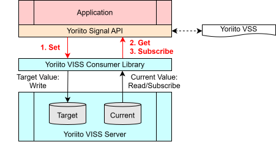

{{ sec_reset(chapter_no) }}

# Part2 Practice

## {{ h2_sec("Building Your First Yoriito Vehicle API Application 📱") }}

### {{ h3_sec("Introduction") }}

In this tutorial, you will learn how to use the Yoriito Signal API through sample code and a sample application. By running the development environment you built in Chapter 4, you can experience application development using the Yoriito Signal API.


### {{ h3_sec("Basics") }}

The Yoriito Signal API is a set of APIs that correspond one-to-one with Yoriito VSS.  
It consists of:

1.  Get – to obtain the current value  
1.  Set – to set a target value  
1.  Subscribe – to continuously receive changes in the current value  

This section shows sample code for each of these.



For more details on the Yoriito Signal API, see ["2. System Configuration/Scope/Versioning"](../02_system_scope_versioning/02_system_scope_versioning.md). For more details on VSS, see ["3. VSS/VISS"](../03_VSS_VISS/03_vss_viss.md).

Try running and modifying the sample code, and apply it to your own application development. To check the behavior of the sample code, make sure to start the simulator first by following "4-7. Start the simulator".

#### {{ h4_sec("Check the current state of the high beam: Get") }}

**What is `Get`?**  

- `Get` is used when you want to obtain the current value.
- You can call `Get` for signals whose type is Actuator / Sensor / Attribute.

**Sample code** (`yoriito-tutorial/tutorial/get/src/main.cc`)

- The following code retrieves the current high-beam state (ON/OFF).

```cpp
#include "yoriito/yoriito_log.h"
#include <yoriito/signal/body/Body.h>

namespace {
constexpr int kExitOk = 0;
constexpr int kExitNg = 1;
} // namespace

int main() {
  YORIITO_LOG_INITIALIZE("get");

  yoriito::Result<bool> result =
      yoriito::vehicle::body::lights::beam::high::ison::Get();

  if (result.IsErr()) {
    auto err = result.TakeErr();
    YORIITO_LOG_INFO("get", std::string("Get failed: ") + err->Message() +
                               " (code=" + std::to_string(err->ErrorCode()) +
                               ")");
    return kExitNg;
  }

  auto value = result.TakeOk().value();

  YORIITO_LOG_INFO("get",
                  std::string("Get succeed: ") + (value ? "true" : "false"));

  return kExitOk;
}
```

**Build & run steps**  

1. Start the simulator if it is not running yet. Running `./init_pal.sh` takes about 3–5 minutes.

    ```shell
    $ cd /work/ref_pal
    $ npm install
    $ ./init_pal.sh
    $ npx electron . --no-sandbox
    ```

1. Build

    ```shell
    $ cd /work/tutorial/get
    $ cmake -S . -B build
    $ cmake --build build -j
    ```

1. Run

    ```shell
    $ ./build/get
    [Wed Feb 25 06:19:03 2026] [INFO] Get succeed: false
    ```

!!! info
    If you see output like the following, try running `./init_pal.sh`:
    ```shell
    $ ./build/get 
    2026-02-25T06:14:00.747Z,2372,139765197864256,SAPI_SignalAPI,ERROR,Get,42,No data.
    [Wed Feb 25 06:14:00 2026] [ERROR] Get failed: No data. (code=61)
    ```

**Example use cases**  

- Display the current state on the screen
    - e.g., get "High beam: ON/OFF", "Wiper: AUTO" and reflect them in the UI
- Get the current value only when needed
    - e.g., fetch values only when the user presses a "Refresh" button

#### {{ h4_sec("Turn on the high beam: Set") }}

**What is `Set`?**  

- `Set` is used when you want to set a target value.
- You can call `Set` only for signals whose type is Actuator.

**Sample code** (`yoriito-tutorial/tutorial/set/src/main.cc`)

```cpp
#include "yoriito/yoriito_log.h"
#include <yoriito/signal/body/Body.h>

namespace {
constexpr int kExitOk = 0;
constexpr int kExitNg = 1;
} // namespace

int main() {
  YORIITO_LOG_INITIALIZE("set");

  const bool is_on = true;
  yoriito::Result<void> set_result =
      yoriito::vehicle::body::lights::beam::high::ison::Set(is_on);

  if (set_result.IsErr()) {
    const yoriito::Result<void>::ErrorPtr err = set_result.TakeErr();
    YORIITO_LOG_INFO("set", std::string("Set failed: ") + err->Message() +
                               " (code=" + std::to_string(err->ErrorCode()) +
                               ")");
    return kExitNg;
  }

  YORIITO_LOG_INFO("set",
                  std::string("Set succeed: ") + (is_on ? "true" : "false"));

  return kExitOk;
}
```

**Build & run steps**  

1. Start the simulator if it is not running yet. Running `./init_pal.sh` takes about 3–5 minutes.

    ```shell
    $ cd /work/ref_pal
    $ npm install
    $ ./init_pal.sh
    $ npx electron . --no-sandbox
    ```

1. Build

    ```shell
    $ cd /work/tutorial/set
    $ cmake -S . -B build
    $ cmake --build build -j
    ```

1. Run

    ```shell
    $ ./build/set
    [Wed Feb 25 06:29:32 2026] [INFO] Set succeed: true
    ```

!!! info
    If you see output like the following, try running `./init_pal.sh`:
    ```shell
    $ ./build/set 
    2026-02-25T06:49:44.130Z,6448,140108347792704,SAPI_SignalAPI,ERROR,Set,92,No data.
    [Wed Feb 25 06:49:44 2026] [ERROR] Set failed: No data. (code=61)
    ```

**Example use cases**  

- Control vehicle functions based on user operations
    - e.g., high beam ON/OFF, A/C temperature setting, seat heater ON/OFF etc.

#### {{ h4_sec("Receive high-beam state changes: Subscribe") }}

**What is `Subscribe`?**  

- `Subscribe` is used when you want to continuously receive changes in the current value.
- You can call `Subscribe` for signals whose type is Actuator / Sensor.

**Sample code** (`yoriito-tutorial/tutorial/subscribe/src/main.cc`)

```cpp
#include "yoriito/yoriito_log.h"
#include <yoriito/signal/body/Body.h>

namespace {
constexpr int kExitOk = 0;
constexpr int kExitNg = 1;
} // namespace

int main() {
  YORIITO_LOG_INITIALIZE("subscribe");
  auto sub_result =
      yoriito::vehicle::body::lights::beam::high::ison::Subscribe();

  if (sub_result.IsErr()) {
    auto err = sub_result.TakeErr();
    YORIITO_LOG_INFO("subscribe",
                    std::string("Subscribe failed: ") + err->Message() +
                        " (code=" + std::to_string(err->ErrorCode()) + ")");
    return kExitNg;
  }

  auto subscription_context = sub_result.TakeOk().value();
  YORIITO_LOG_INFO("subscribe", "Subscribe succeeded. Waiting for updates...");

  while (true) {
    auto msg_result = subscription_context->Messages();
    if (msg_result.IsErr()) {
      auto err = msg_result.TakeErr();
      YORIITO_LOG_INFO("subscribe",
                      std::string("Messages() failed: ") + err->Message() +
                          " (code=" + std::to_string(err->ErrorCode()) + ")");
      break;
    }

    auto response = msg_result.TakeOk().value();
    const auto &data_points = response.GetDataPoints();
    const auto &data_point = data_points.front();
    auto data = data_point.GetData();
    const bool is_on = std::get<bool>(data);

    YORIITO_LOG_INFO("subscribe",
                    std::string("IsOn updated: ") + (is_on ? "true" : "false"));
  }

  return kExitOk;
}
```

**Build & run steps**  

1. Start the simulator if it is not running yet. Running `./init_pal.sh` takes about 3–5 minutes.

    ```shell
    $ cd /work/ref_pal
    $ npm install
    $ ./init_pal.sh
    $ npx electron . --no-sandbox
    ```

1. Build

    ```shell
    $ cd /work/tutorial/subscribe
    $ cmake -S . -B build
    $ cmake --build build -j
    # If not already done, build Set as well
    $ cd /work/tutorial/set
    $ cmake -S . -B build
    $ cmake --build build -j
    ```

1. Run
    - First, run `Subscribe`:

        ```shell
        $ ./build/subscribe 
        [Wed Feb 25 06:53:54 2026] [INFO] Subscribe succeeded. Waiting for updates...
        ```

    - Then, in another terminal, run `Set`:

        ```shell
        $ cd /work/tutorial/set
        $ ./build/set
        ```

    - You should see updates on the `Subscribe` side like:

        ```shell
        $ ./build/subscribe
        [Wed Feb 25 06:53:54 2026] [INFO] Subscribe succeeded. Waiting for updates...
        [Wed Feb 25 06:59:32 2026] [INFO] IsOn updated: true
        ```

!!! info
    If you see output like the following, try running `./init_pal.sh`:
    ```shell
    $ ./build/subscribe 
    2026-02-25T06:49:44.130Z,6448,140108347792704,SAPI_SignalAPI,ERROR,Subscribe,92,No data.
    [Wed Feb 25 06:49:44 2026] [ERROR] Subscribe failed: No data. (code=61)
    ```

**Example use cases**

- Reflect state changes in the UI in real time
    - e.g., when the physical high-beam switch changes ON/OFF, the app UI updates immediately
- Detect abnormalities
    - e.g., show a warning if temperature exceeds a specified value


### {{ h3_sec("Advanced") }}

In the Basics section, you learned how to obtain and control vehicle signals using `Get` / `Set` / `Subscribe` of the Yoriito Signal API. In the Advanced section, you will learn concepts needed to develop more realistic applications, along with sample code.

#### {{ h4_sec("Check whether the high beam is available: Availability") }}

**What is `Availability`?**

- In the Basics section, sample code for `Set` / `Get` / `Subscribe` assumed that the high-beam signal is available.
- In real vehicles, however, a signal may or may not be usable depending on the vehicle state and conditions. A function may be available on one vehicle but not on another.
- To inform applications of these differences, `Availability` is provided to represent whether a signal is usable.
- Availability takes either `true` or `false`:
    - `true`: the signal is currently available  
    - `false`: the signal exists but is currently unavailable
- Depending on the kind of signal, two types of Availability are defined:
    - `Availability_Sensor`  
        - Indicates whether the current value can be obtained via `Get`.
    - `Availability_Actuator`  
        - Indicates whether the target value can be set via `Set`.
- For more details on Availability, see "2-5. System behavior".

**Sample code** (`yoriito-tutorial/tutorial/availability/src/main.cc`)

```cpp
#include "yoriito/yoriito_log.h"
#include <yoriito/signal/body/Body.h>

namespace {
constexpr int kExitOk = 0;
constexpr int kExitNg = 1;
} // namespace

int main() {
  YORIITO_LOG_INITIALIZE("availability");
  yoriito::Result<bool> result = yoriito::vehicle::body::lights::fog::front::
      ison_availability_sensor::Get();

  if (result.IsErr()) {
    auto err = result.TakeErr();
    YORIITO_LOG_INFO("availability",
                    std::string("Get failed: ") + err->Message() +
                        " (code=" + std::to_string(err->ErrorCode()) + ")");
    return kExitNg;
  }

  auto value = result.TakeOk().value();

  YORIITO_LOG_INFO("availability",
                  std::string("Get succeed: ") + (value ? "true" : "false"));

  return kExitOk;
}
```

**Build & run steps**  

1. Start the simulator if it is not running yet. Running `./init_pal.sh` takes about 3–5 minutes.

    ```shell
    $ cd /work/ref_pal
    $ npm install
    $ ./init_pal.sh
    $ npx electron . --no-sandbox
    ```

1. Build

    ```shell
    $ cd /work/tutorial/availability
    $ cmake -S . -B build
    $ cmake --build build -j
    ```

1. Run

    ```shell
    $ ./build/availability
    [Wed Feb 25 10:13:14 2026] [INFO] Get succeed: true
    ```

!!! tip
    Try changing the signal in the sample code to another one, then rebuild and run. For example, if you change it to `yoriito::vehicle::body::lights::fog::front::ison_availability_sensor`, it should output `false`.


**Example use cases**

Availability is mainly used in the following situations:

- GUI control
    - Automatically gray out buttons for unavailable functions.
- User guidance
    - Show messages such as "Currently not operable" when conditions are not met (e.g., while driving).
- Check before sending operation requests
    - Verify availability before sending an operation request via the API.

This ensures the UI/application behavior stays consistent with the actual vehicle state.

#### {{ h4_sec("Get detailed information (metadata) of the high beam: Inspect") }}

**What is `Inspect`?**

- In the Basics section, we dealt with Boolean signals. In real vehicles, there are also `int` and `float` signals.
- In such cases, you may want to know the minimum and maximum values.
- For example, for vehicle speed, you may want to know whether the unit is km/h or mph.
- For this purpose, the `Inspect` method is provided.
- By calling `Inspect`, you can get detailed information (metadata) of a signal.
- Key data fields obtainable via `Inspect`:

    | Data            | Meaning                                                             |
    | --------------- | ------------------------------------------------------------------- |
    | `path`          | Full path of the signal (e.g. `Vehicle.Body.Lights.Beam.High.IsOn`) |
    | `datatype`      | Data type (e.g. `boolean`, `int`, `float`, `string`)                |
    | `entry_type`    | Node type: `branch` / `sensor` / `actuator` / `attribute`           |
    | `unit`          | Unit (e.g. `km/h`, `%`, `°C`)                                       |
    | `min`           | Minimum value                                                       |
    | `max`           | Maximum value                                                       |
    | `comment`       | Additional notes                                                    |
    | `allowed`       | Allowed values (e.g. `['AUTO', 'LOW', 'MID', 'HIGH']`)              |
    | `default_value` | Default value                                                       |
    | `description`   | Description of the signal                                           |
    | `array_size`    | Number of elements if it is an array                                |


**Sample code** (`yoriito-tutorial/tutorial/inspect/src/main.cc`)

```cpp
#include "yoriito/yoriito_log.h"
#include <yoriito/signal/body/Body.h>

namespace {
constexpr int kExitOk = 0;
constexpr int kExitNg = 1;
} // namespace

int main() {
  YORIITO_LOG_INITIALIZE("inspect");

  yoriito::Result<yoriito::databroker::ConsumerInspectResponse> result =
      yoriito::vehicle::body::lights::beam::high::ison::Inspect();

  if (result.IsErr()) {
    auto err = result.TakeErr();
    YORIITO_LOG_INFO("inspect",
                    std::string("Inspect failed: ") + err->Message() +
                        " (code=" + std::to_string(err->ErrorCode()) + ")");
    return kExitNg;
  }

  auto inspect_response = result.TakeOk().value();

  if (inspect_response.GetDataPoints().empty()) {
    YORIITO_LOG_INFO("inspect", "Inspect failed: No data points returned.");
    return kExitNg;
  }

  const yoriito::databroker::ConsumerInspectData &inspect_data =
      inspect_response.GetDataPoints().front();

  const auto &path = inspect_data.GetPath();
  // const auto &data_type = inspect_data.GetDataType();
  // const auto &entry_type = inspect_data.GetEntryType();
  // const auto &deprecation = inspect_data.GetDeprecation();
  // const auto &unit = inspect_data.GetUnit();
  // const auto &min = inspect_data.GetMin();
  // const auto &max = inspect_data.GetMax();
  // const auto &comment = inspect_data.GetComment();
  // const auto &allowed = inspect_data.GetAllowed();
  // const auto &default_value = inspect_data.GetDefaultValue();
  const auto &description = inspect_data.GetDescription();
  // const auto &array_size = inspect_data.GetArraySize();
  // const auto &pattern = inspect_data.GetPattern();
  // const auto &custom_attributes = inspect_data.GetCustomAttributes();

  YORIITO_LOG_INFO("inspect", "Inspect succeed");
  YORIITO_LOG_INFO("inspect", std::string("Path: ") + path);
  YORIITO_LOG_INFO("inspect", std::string("Description: ") + description);

  return kExitOk;
}
```

**Build & run steps**  

1. Start the simulator if it is not running yet. Running `./init_pal.sh` takes about 3–5 minutes.

    ```shell
    $ cd /work/ref_pal
    $ npm install
    $ ./init_pal.sh
    $ npx electron . --no-sandbox
    ```

1. Build

    ```shell
    $ cd /work/tutorial/inspect
    $ cmake -S . -B build
    $ cmake --build build -j
    ```

1. Run

    ```shell
    $ ./build/inspect 
    [Wed Feb 25 10:58:35 2026] [INFO] Inspect succeed
    [Wed Feb 25 10:58:35 2026] [INFO] Path: Vehicle.Body.Lights.Beam.High.IsOn
    [Wed Feb 25 10:58:35 2026] [INFO] Description: Indicates if light is on or off. True = On. False = Off.
    ```

**Example use cases**

Inspect is mainly used in the following situations:

- Check before sending operation requests
    - Confirm that the value to be set is within the min/max range of the signal.
- GUI control
    - Display min/max values for temperature settings or window opening degree.
    - Prevent users from setting values outside the valid range.
- Support multiple vehicle types
    - Obtain the correct range even when controllable ranges differ across vehicle types and equipment.

#### {{ h4_sec("Control the simulator vehicle via Text User Interface (TUI)") }}

So far, you have learned the Yoriito Signal API through coding. VSS defines many more signals, and various applications can be developed using them.

Writing code each time just to check a signal's behavior is time-consuming.
For this purpose, a Text User Interface is provided. For usage, see "Connect vshot" in [the PAL developer tutorial](../07_develop_pal/07_develop_pal.md).


### {{ h3_sec("Troubleshooting") }}

#### {{ h4_sec('"Tools or libraries not found" errors occur') }}

- Cause  
    You may be running commands in the host environment instead of inside the container.

- Countermeasure  
    - Start the container as described in ["4-6. Start the container"](../04_environment_setup/04_environment_setup.md) and run commands in a terminal inside the container.  
    - All required tools and libraries are already installed in the container.
    

#### {{ h4_sec('Error saying "Cannot connect to `localhost (127.0.0.1)`"') }}

- Cause  
    Even local communication (`localhost` / `127.0.0.1`) may be routed through a proxy, which can prevent a proper connection to `localhost`.
    
- Countermeasure  
    - Check the proxy-related environment variables (`no_proxy` / `NO_PROXY`) in the container.  
    - Running the following commands in the container terminal may resolve the issue:

        ```shell
        $ export no_proxy=127.0.0.1,localhost  
        $ export NO_PROXY=127.0.0.1,localhost  
        ```

    - If this resolves the issue, add `remoteEnv` to `.devcontainer/devcontainer.json` so that the setting  persists after restarting the container. After changing the settings, rebuild the Dev Container.

        ```json
        "remoteEnv": {
          "no_proxy": "127.0.0.1,localhost",
          "NO_PROXY": "127.0.0.1,localhost"
        },
        ```
