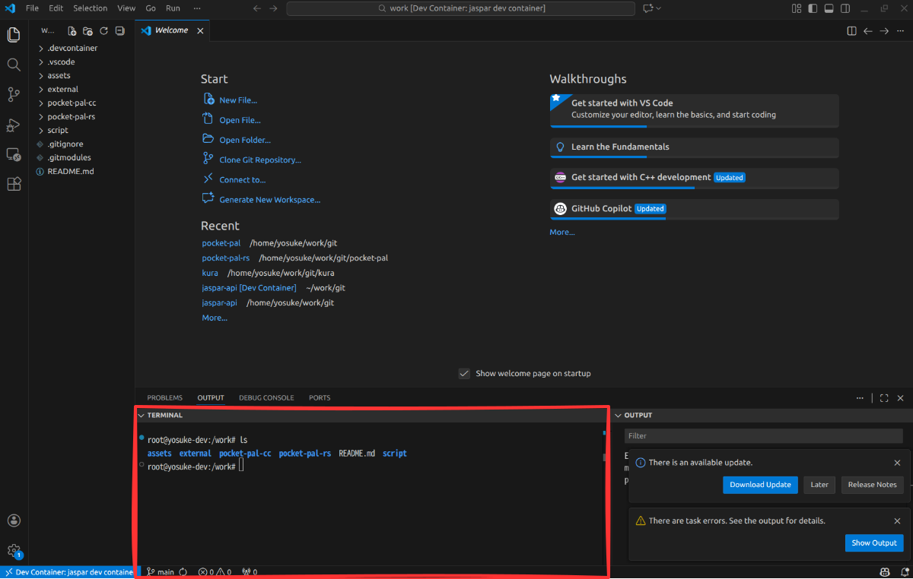
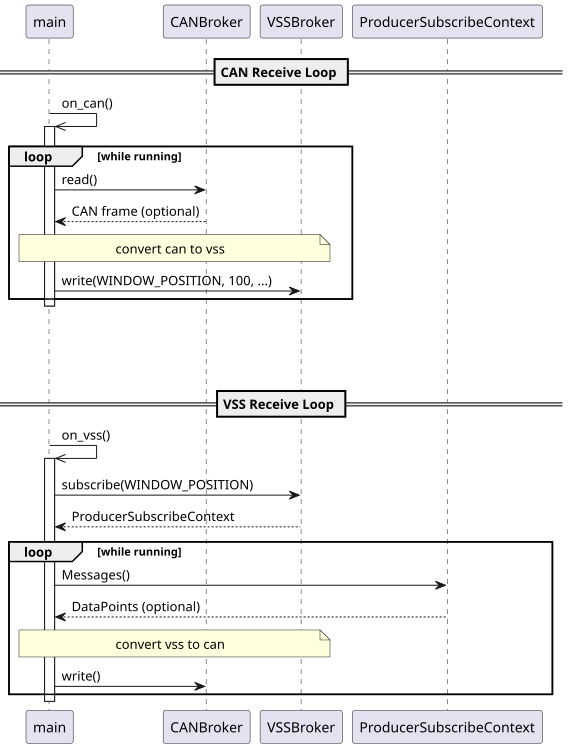
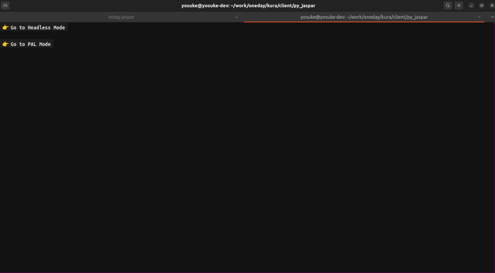
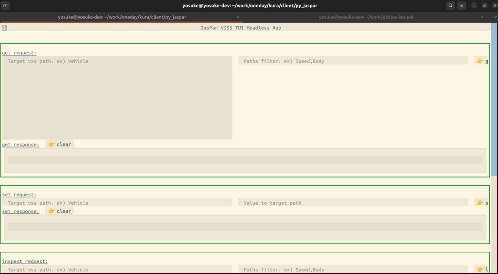
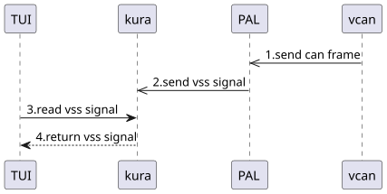

{{ sec_reset(chapter_no) }}

# Part2 Practice

## {{ h2_sec("Developing a custom PAL to connect CAN and Kura 🚗") }}

### {{ h3_sec("Introduction") }}

This page explains how readers can develop their own PAL to connect CAN and Kura. This page assumes the following knowledge:  

- [VSS/VISS](../03_VSS_VISS/03_vss_viss.md)


### {{ h3_sec("Set Up the Development Environment") }}

#### {{ h4_sec("Clone the yoriito-tutorial repository") }}

This tutorial uses sample `PAL` called `pocket-pal`.   
`yoriito-tutorial` repository contains `pocket-pal`, so at first, please clone `yoriito-tutorial`. `pocket-pal` is located in the pocket-pal directory.  

```shell
$ git clone https://github.com/yoriito/yoriito-tutorial.git
```

`pocket-pal` uses vcan device, so you need a vcan (Virtual CAN interface), so create it as follows:  

```shell
$ bash yoriito-tutorial/pocket-pal/script/setup_vcan.sh
```

This script performs the following operations, so you can also execute them manually:  

```shell
# load vcan module
$ sudo modprobe vcan
# create virtual CAN device (vcan0) as a network device
$ sudo ip link add dev vcan0 type vcan
# set status to `UP`
$ sudo ip link set up vcan0
```

#### {{ h4_sec("Start the development Docker container") }}

`yoriito-tutorial` provides a development Docker container for yoriito project.   
From the root of `yoriito-tutorial` repository, launch VS Code and start the development Docker container for the pocket-pal directory by following the steps described there.  

<video controls width="800">
  <source src="../assets/dev-container.mp4" type="video/mp4">
</video>

When you run shell commands in the following location in VS Code, they will be executed inside the development Docker container.  


    
!!! warning

    ⚠️ Unless otherwise noted, the following assumptions apply to subsequent code blocks:  
    
    - Commands are executed inside this development container.  
    - The current directory is /work/pocket-pal in the cloned repository.  

### {{ h3_sec("Develop a PAL") }}

#### {{ h4_sec("Design of pocket-pal-cc") }}

Before staring your custom PAL, let's take a look at the design of `pocket-pal-cc`. pocket-pal-cc consists of three C++ source files and CMakeLists.txt as follows.  

```shell
$ tree -L 1 pocket-pal-cc 
pocket-pal-cc
├── build
├── can_broker.h
├── CMakeLists.txt
├── main.cpp
└── vss_broker.h
2 directories, 4 files
```

Their responsibilities are as follows.  

| **file**         | **responsibility**                                                                                                       |
|------------------|--------------------------------------------------------------------------------------------------------------------------|
| `main.cpp`       | - Implements the entry point of pocket-pal <br> - Receives CAN from vcan, converts it to VSS, and writes it to Kura<br> - Receives VSS from Kura, converts it to CAN, and writes it to vcan<br> - Manages the threads that execute the above functions |
| `can_broker.h`   | - Provides write functions to vcan<br> - Provides read functions from vcan                                               |
| `vss_broker.h`   | - Provides write functions to Kura<br> - Provides subscribe functions for specific VSS data in Kura                      |
| `CMakeLists.txt` | - Describes CMake configuration for pocket-pal-cc<br> - Adds header search paths<br> - Links libraries                    |
| `build`          | - Working directory for building                                                                                        |


#### {{ h4_sec("Build and run pocket-pal-cc") }}

Now you understand how pocket-pal-cc works, let's build and run it. You can build and run it with the following steps:  

```shell
# Build
$ mkdir pocket-pal-cc/build && cd pocket-pal-cc/build
$ cmake ..
$ make
# Run
$ ./pocket-pal
```

This sample pal runs in a loop, reading CAN frames from vcan, converting them to VSS, and writing them to Kura. For more details, see the following diagram.  



#### {{ h4_sec("Modify pocket-pal-cc") }}

##### Modify CAN → VSS conversion

Here we modify the implementation that receives a CAN signal from vcan, converts it to VSS, and writes it to Kura. This process is implemented in the [main.cpp(link)](https://github.com/yoriito/yoriito-tutorial/blob/main/pocket-pal/pocket-pal-cc/main.cpp).  

```cpp
void on_can(std::shared_ptr<CANBroker> can_broker) {
  while (running) {
    auto frame = can_broker.get()->read();
    if (!frame.has_value()) {
      continue;
    }
    auto valid_frame = frame.value();
    YORIITO_LOG_INFO("CAN", "[RECV] id: " + std::to_string(valid_frame.can_id) +
                                ", data: " + format_can_data(valid_frame));

    VSSBroker::write<std::uint8_t>(WINDOW_POSITION, 100, true, true);
    YORIITO_LOG_INFO("VSS", "[SEND] path: " + std::string(WINDOW_POSITION) +
                                ", payload: 100");
  }
}
```

As shown above, the data received from vcan is stored in the variable `valid_frame`. The code writes the value 100 to Kura with the path WINDOW_POSITION (=`Vehicle.Cabin.Door.Row1.DriverSide.Window.Position`).  

For example, if you want to modify the implementation so that when the received CAN ID is 0x100, the first byte of the CAN payload is treated as window position and written to Kura, it will look like this.  

```diff
void on_can(std::shared_ptr<CANBroker> can_broker) {
  while (running) {
    auto frame = can_broker.get()->read();
    if (!frame.has_value()) {
      continue;
    }
    auto valid_frame = frame.value();
    YORIITO_LOG_INFO("CAN", "[RECV] id: " + std::to_string(valid_frame.can_id) +
                                ", data: " + format_can_data(valid_frame));

-   VSSBroker::write<std::uint8_t>(WINDOW_POSITION, 100, true, true);
-   YORIITO_LOG_INFO("VSS", "[SEND] path: " + std::string(WINDOW_POSITION) +
-                               ", payload: 100");
+   if (valid_frame.can_id == 0x100) {
+     auto position = static_cast<std::uint8_t>(valid_frame.data[0]);
+     VSSBroker::write<std::uint8_t>(WINDOW_POSITION, position, true, true);
+     YORIITO_LOG_INFO(
+         "VSS", "[SEND] path: " + std::string(WINDOW_POSITION) +
+                    ", payload: " +
+                    std::to_string(static_cast<unsigned int>(position)));
+   }
  }
}
```

When you actually develop a `PAL`, you will update VSS data in Kura based on the received CAN frame in this way.  

##### Modify VSS → CAN conversion

Here we modify the implementation that receives VSS from Kura, converts it to CAN, and writes it to vcan. This process is implemented in the [main.cpp(link)](https://github.com/yoriito/yoriito-tutorial/blob/main/pocket-pal/pocket-pal-cc/main.cpp).  

As shown in above link, the data received from Kura is stored in the variable `data_point`. The code writes a hard-coded payload to vcan with CAN ID 256.  

For example, if you want to modify the implementation so that when the received VSS path is `Vehicle.Cabin.Door.Row1.DriverSide.Window.Position`, you send a CAN frame with ID 255 to vcan,   
using the received window position as the first byte of the payload, it will look like this.  

```diff
void on_vss(std::shared_ptr<CANBroker> can_broker){
...
-           // TODO: users need to build any can frame from data_point
-           can_broker.get()->write(256, {0x27, 0x10, 0x1F, 0x40, 0x00, 0x00, 0x00, 0x00});
-           YORIITO_LOG_INFO("CAN", "[SEND] id: 256, payload: "
-                                   "27 10 1f 40 00 00 00 00");
+           if (path == WINDOW_POSITION) {
+               auto position = std::get<std::uint8_t>(value);
+               can_broker.get()->write(255, {position, 0x10, 0x1F, 0x40, 0x00, 0x00, 0x00, 0x00});
+               YORIITO_LOG_INFO(
+                   "CAN", "[SEND] id: 255, payload: " +
+                              std::to_string(static_cast<unsigned int>(position)) +
+                              " 10 1f 40 00 00 00 00");
+           }
        }
    }
}
```

When you actually develop a `PAL`, you will send CAN frames to vcan based on the received VSS data in this way.  


### {{ h3_sec("Verify the Behavior") }}

This section explains how to verify the behavior by writing CAN data to pocket-pal-cc or writing VSS data and checking the result.  

#### {{ h4_sec("Connect vshot") }}

To verify the behavior of pocket-pal-cc, you need an application that reads and writes VSS to Kura. For this purpose, a simple CLI command (vshot) is provided.  

- <https://github.com/yoriito/kura/tree/main/client/vshot>

You can use this CLI with the following commands.  

```shell
# build
$ git clone https://github.com/yoriito/kura.git
$ cd kura/client/vshot
$ make build
$ make install
# run
$ vshot tui                           # Use TUI mode
$ vshot -i                            # Use interactive mode
$ vshot get-current Vehicle.Cabin.Door.Row1.DriverSide.Window.Position     # Get the current value of Vehicle.Cabin.Door.Row1.DriverSide.Window.Position
$ vshot set-current Vehicle.Cabin.Door.Row1.DriverSide.Window.Position 100 # Set the current value of Vehicle.Cabin.Door.Row1.DriverSide.Window.Position to 100
```

For example, when you run it as a TUI, the following screen is displayed.  



When you press `Go to Headless Mode`, the following screen is displayed.  



To write VSS to Kura, `set` the path and value in the `set_request` field and press the set button, as shown in the video.  

<video controls width="800">
  <source src="../assets/tui.mp4" type="video/mp4">
</video>

<a id="Write a CAN frame to vcan and verify that it is written to Kura as VSS"></a>
#### {{ h4_sec("Write a CAN frame to vcan and verify that it is written to Kura as VSS") }} 

First, run pocket-pal-cc inside the development Docker container:  

```shell
$ ./pocket-pal-cc/build/pocket-pal
```

Then, follow these steps.  



The detailed steps are as follows.  

1. Send a CAN frame  
  Run the following command in a shell. You can run this either inside the development Docker container or on the host OS.  
  ```shell
  $ cansend vcan0 123#1122334455667788
  ```
1. Send a VSS signal  
  After step 1, PAL converts the received data to a VSS signal and notifies Kura.  
1. Read the VSS signal  
  Use the TUI to get the value. If you have not modified pocket-pal, the path to get is `Vehicle.Cabin.Door.Row1.DriverSide.Window.Position`.  
1. Check the returned VSS signal  
  The TUI returns the value of `Vehicle.Cabin.Door.Row1.DriverSide.Window.Position`. If you have not modified pocket-pal, you should get 100.  


#### {{ h4_sec("Write VSS to Kura and verify that a CAN frame is written to vcan") }}


Refer to [Write a CAN frame to vcan and verify that it is written to Kura as VSS](#7-4-2-write-a-can-frame-to-vcan-and-verify-that-it-is-written-to-kura-as-vss) and write VSS data to Kura from the TUI.  

You can monitor vcan with the following command (this can also be run either inside the development Docker container or on the host OS).

```shell
$ candump vcan0
```

### {{ h3_sec("Troubleshooting") }}

#### {{ h4_sec("No such device error occurs when running pocket-pal-cc") }}

- Symptom    
    ```bash
    $ ./pocket-pal-cc/build/pocket-pal
    ioctl SIOCGIFINDEX failed, errno=19 (No such device)
    terminate called after throwing an instance of 'std::runtime_error'
    what():  Failed to get interface index
    Aborted (core dumped)
    ```
- Cause    
    The vcan device has not been created.  
- Countermeasure  
    Create vcan by [link](#7-2-2-create-vcan).  


#### {{ h4_sec("Cannot install required pip packages for the TUI") }}

- Symptom    
    ```shell
    $ python3 -m pip install textual grpcio protobuf textual_autocomplete
    error: externally-managed-environment
    × This environment is externally managed
    ╰─> To install Python packages system-wide, try apt install
        python3-xyz, where xyz is the package you are trying to
        install.
        If you wish to install a non-Debian-packaged Python package,
        create a virtual environment using python3 -m venv path/to/venv.
        Then use path/to/venv/bin/python and path/to/venv/bin/pip. Make
        sure you have pypy3-venv installed.
        If you wish to install a non-Kali-packaged Python application,
        it may be easiest to use pipx install xyz, which will manage a
        virtual environment for you. Make sure you have pipx installed.
        For more information, refer to the following:
        * https://www.kali.org/docs/general-use/python3-external-packages/
        * /usr/share/doc/python3.13/README.venv
    note: If you believe this is a mistake, please contact your Python installation or OS distribution provider. You can override this, at the risk of breaking your Python installation or OS, by passing --break-system-packages.
    hint: See PEP 668 for the detailed specification.
    ```
- Cause  
    From Python 3.12 onward, installing packages with pip is assumed to be done in a venv environment.  
- Countermeasure  
    Use a venv as follows.

    ```shell
    $ python3 -m venv .
    $ source bin/activate
    ```

    Alternatively, if you are fine with installing packages into the global system, you can avoid the problem with the following command.

    ```shell
    $ python3 -m pip install textual grpcio protobuf textual_autocomplete --break-system-packages
    ```


#### {{ h4_sec("When starting the TUI, VISS server(localhost:50052) is not running. is displayed") }}

- Symptom    
    ```shell
    $ ./main.py 
    VISS server(localhost:50052) is not running.
    ```
- Cause  
    The development Docker container in the pocket-pal repository is not running.  
- Countermeasure    
    Start the development Docker container by referring to [link](#7-2-3-start-the-development-docker-container)  


#### {{ h4_sec("Cannot use vcan on WSL2") }}

- Symptom  
    ```shell
    $ sudo modprobe vcan
    modprobe: FATAL: Module vcan not found in directory /lib/modules/....
    ```
- Cause  
    The standard WSL2 kernel does not include the vcan module.  
- Countermeasure   
    Resolve the issue by referring to the following information.  
    Note that the location of configuration items may have changed.  
    Within this project, the following procedure has been confirmed to work.  
    ```shell
    git clone --depth 1 -b linux-msft-wsl-6.6.y https://github.com/microsoft/WSL2-Linux-Kernel.git
    cd ~/WSL2-Linux-Kernel
    make mrproper
    zcat /proc/config.gz > .config
    printf "CONFIG_CAN=m\nCONFIG_CAN_RAW=m\nCONFIG_CAN_BCM=m\nCONFIG_CAN_GW=m\nCONFIG_CAN_DEV=m\nCONFIG_CAN_VCAN=m\n" >> .config
    make olddefconfig
    make modules -j$(nproc)
    sudo make modules_install
    ```
